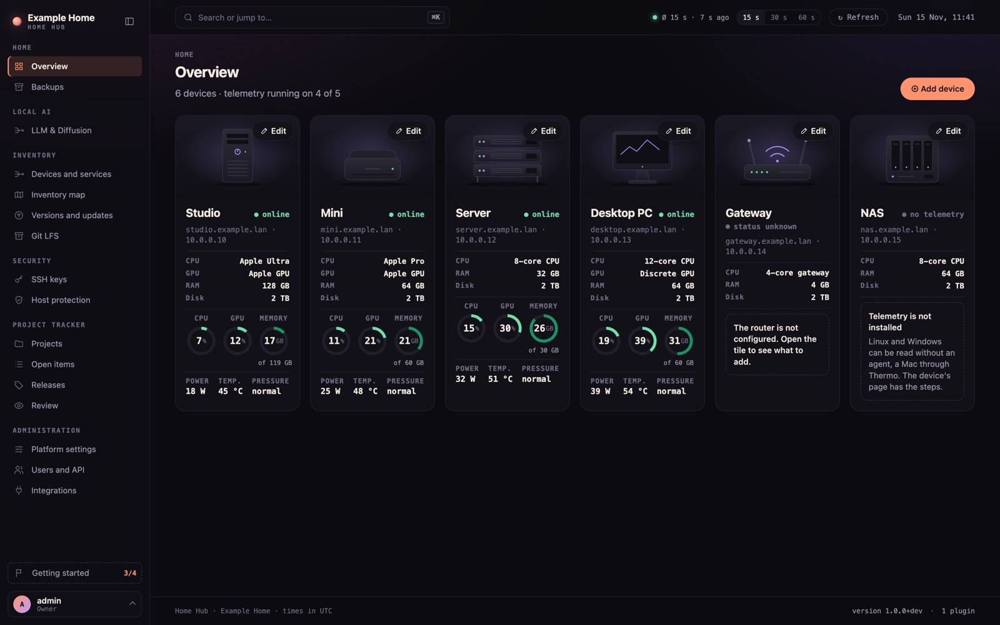
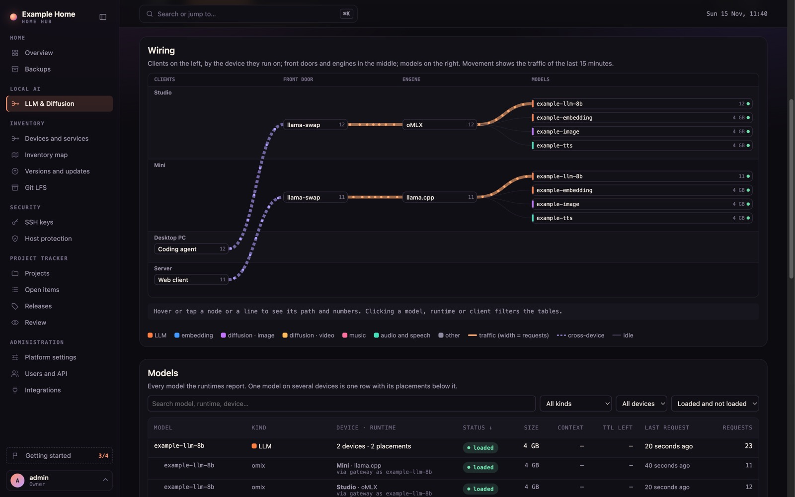
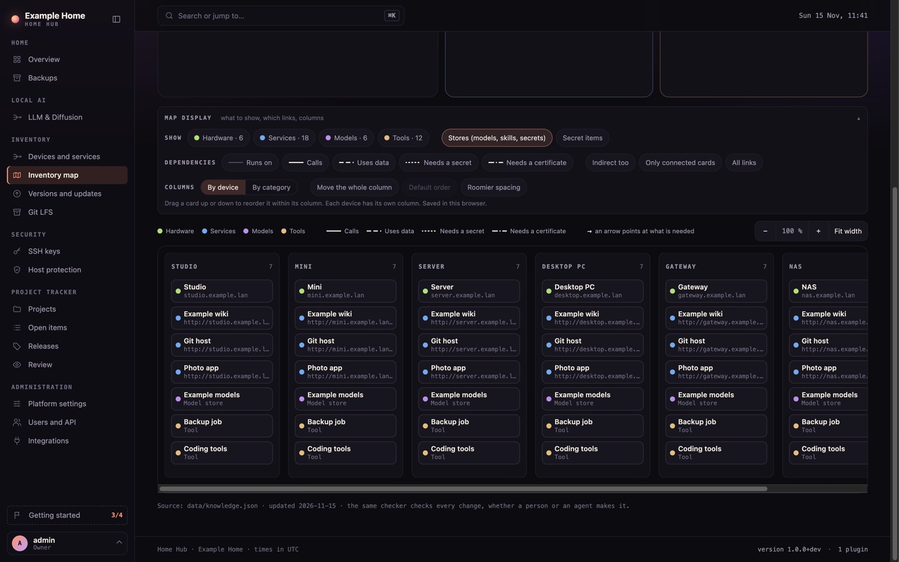

# Home Hub
<!-- home-hub:public-readme -->

Home Hub is a self-hosted hub for a household's devices, services, software and work.
It includes an overview with telemetry, an inventory map, a local LLM runtimes view,
a project tracker and review, an HTTP API and MCP endpoint, and plugins.

## Screenshots

These screenshots use a mock instance with placeholder devices and data.

**Overview** — device cards, telemetry and Add device.



**LLM & Diffusion** — Wiring connects clients, front doors, engines and models by device.



**Inventory map** — hardware, services, models and tools arranged by device.



## Quick start

You need Git and Node 22.13 or newer. There are no packages to install.
Use the clone URL from this repository's Code button:

```sh
git clone <repository-url> home-hub
cd home-hub
export HOME_HUB_HOME="$HOME/.local/share/home-hub"
node scripts/setup.mjs
LOCAL_PREVIEW=1 PORT=8799 node server/index.mjs
```

Open http://127.0.0.1:8799 and sign in. The first sign-in opens **Getting started**,
with steps for connecting an agent, adding devices and filling the inventory.
The preview uses HTTP on loopback. See [Getting started](docs/getting-started.md)
for installation and [Docker](docs/docker.md) for a container deployment.

## What works out of the box

- Add devices with **Add device** on the Overview. Connect Thermo for telemetry,
  or use the [push agent](docs/agent.md) for device reports; agent-less telemetry
  sources are also supported. See [features](docs/features.md).
  Thermo is a separate app; this release does not yet link a public installer.
- Device detail pages show hardware, telemetry and runtime stacks. Define the
  device's runtime endpoints and inventory entries, or let your coding agent
  create the initial inventory through the API or MCP endpoint.
- Plugins add pages, routes, MCP tools and collectors. Household configuration
  and plugin sources live outside core; see [storage](docs/storage.md).

## Plugins

Plugins live in a separate repository, [homehub-plugins](https://github.com/slaader/homehub-plugins); example plugins
include UniFi and macOS runtimes. A plugin source is a directory registered in
`instance.json`. See [the plugin guide](docs/plugins.md) for registration,
configuration and the core extension points.

## Documentation

- [Getting started](docs/getting-started.md) — install, sign in and connect an agent.
- [Features](docs/features.md) — devices, telemetry, runtimes, tracker and security.
- [Configuration](docs/configuration.md) — site settings and environment variables.
- [Docker](docs/docker.md) — containers, volumes and reverse proxy setup.
- [Updating](docs/updating.md) — update checks, applying releases and rollback.
- [Plugins](docs/plugins.md) — plugin sources and extension contract.
- [HTTP API and MCP](docs/API.md) — routes, tools, scopes and write validation.
- [Push agent](docs/agent.md) — installation, reports and access.
- [Services](docs/services.md) — registering services on devices.
- [Review](docs/review.md) — alternatives, feedback and uploads.
- [Storage](docs/storage.md) — configuration, state and secret locations.
- [Design](docs/design.md) — design tokens and shared UI components.
- [Git LFS view](docs/git-lfs.md) — inspecting objects on git hosts.
- [Rust MCP](docs/rust-mcp.md) — Rust MCP implementation reference.

## Connect your agent

Create a scoped service-account key in Users and API, then connect to `/mcp`.
See [Getting started](docs/getting-started.md).

## Security model

Keep the hub on a LAN or VPN. API keys never reach administration.
See [security details](docs/features.md#security-model).

## Updating and contributing

Home Hub reports available releases; updates are applied with the command in
[Updating](docs/updating.md), which also explains what the update check contacts.

Run `npm test` for the complete core suite. Read [AGENTS.md](AGENTS.md) before
contributing; [SPEC.md](SPEC.md) describes the application requirements.

## Licence

MIT, see [LICENSE](LICENSE).
