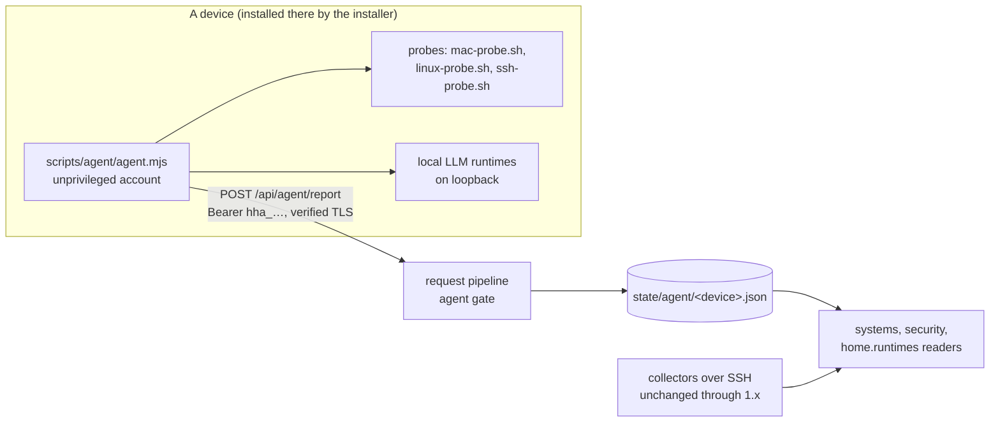

# The push agent

> **Steps 0 to 5 are built and part of 1.0.0; step 6 and 2.0 are not** (§7). Built: the agent credential, the route
> gate, `POST /api/agent/report`, the report store, the agent audit, the admin API and CLI and the leaf modules (step 1;
> `docs/API.md` → Push agent is the public contract), the readers that join the agents' records (§3 → Who wins over the
> collectors; step 2), the Linux probe (3a), the agent for macOS and Linux with its installer
> (3b; [As built](#step-3b-as-built) below), the overview and pages (4; [As built](#step-4-as-built) below) and the
> PowerShell agent for Windows (5; [As built](#step-5-as-built)), with the launchd daemon for macOS (Step 3b as
> built → The launchd daemon). The Linux system service and the Windows agent have each run on one real computer; each "As built" ends with that run's checklist and what it did not verify, and the launchd
> daemon's with what its first real Mac checks. Not built: the deprecations of step 6 and the removals of 2.0. Everything else below is the contract those build against; a step that has to depart
> from it changes this file in the same commit.

Today the hub learns about a device by reaching into it: the collectors log in over SSH and run a probe
(`scripts/collect-systems.mjs`, `scripts/collect-security.mjs`), and the agent-less telemetry providers log in over
SSH or WinRM. The push agent turns the first half around. Every device runs one generic agent from core that
**sends** what it knows to the hub: the operating system and its updates, watched packages, LLM runtimes, SSH keys
and a heartbeat. The hub keeps **pulling** what is pulled best: metrics exporters (Thermo, Node Exporter,
Prometheus), the router, and the NAS over SSH as today.



## What stays as it is

- **The NAS** stays agent-less, on the SSH `nas-probe.sh` (which calls `sudo midclt`) through 1.x; nothing installs
  Node on an appliance. A reader for the TrueNAS API is separate, later work that this design does not cover.
- **The router**: `scripts/collect-router-unifi.py` is not rewritten and keeps running where it runs.
- **No ping.** Reachability, when it comes, is a separate TCP signal and is not part of this design.
- **No probe field in `plugin.json`** in this series: an older core refuses a manifest field it does not know.
- **Old paths keep working through 1.x**: `plugin.json → hostAgents`, `scripts/install-host-agent.mjs --plugin`, the
  SSH collectors and the SSH and WinRM telemetry providers. They may be deprecated in a MINOR and are removed only in
  2.0, after the owner agrees. No plugin manifest that 1.x accepts today is refused because of this design.
- **Controls stay in plugins.** Core carries no start, stop or restart (see [Later: a mailbox](#later-a-mailbox)).

**The invariant.** The hub never delivers code, probes, commands or agent configuration to a device. Everything
an agent runs or obeys reaches the device through the installer, run on that device by a person, and the agent
checks it again before it runs it. The hub's only answer to an agent is a status code and a short acknowledgement,
and the agent acts on nothing in it beyond when to try again.

## 1. Device identity

An agent reports as **one id of the overview's device namespace**: a `site.json → devices[].id`, or the id of a
device added on the overview (`state/home/devices.json`). The two never collide: site ids are reserved for added
devices (`server/home-devices.mjs`). Thermo host ids and the ids of the router's network clients are not device ids and are never used.

- The device is **bound to the key when the key is issued** and is never part of the report. The report route takes
  the device from the key alone; a report that carries a device field is malformed (closed envelope, below).
- **Site devices.** Today a site device is connected only by a person signed in with a password
  (`server/core/home.mjs → telemetryTarget`). The agent keeps that bar: a key for a site device is issued only by an
  administrator with a password sign-in, or by the local CLI with the hub stopped. Nothing an agent sends changes
  `site.json`, `site-overrides.json` or `devices.json`; it fills only its own record store.
- Refused at issue: an id that names nothing, `role: "router"`, `ssh.probe: "nas"` (the NAS stays agent-less,
  so a device never has two reader kinds), and `platform: "other"` (no report platform could ever match it, so
  the key could deliver nothing). A device whose `platform` is set must report the same one, or every
  part is refused `platform-mismatch` (the hub never guesses which side is right).
- A key whose device later becomes one of these (the site file or the added device changes its role, probe or platform) is
  revoked by the hub the same way as below, with `revokedBy: "device-changed"`.
- **Ids come back; keys do not follow them.** `newDeviceId` avoids only the ids taken now, so a removed device's id can
  be given again. A key binds `{device, deviceCreatedAt}` (an added device's `createdAt`; `null` for a site device) and
  works only while the device exists with that stamp. When the hub sees it gone or re-created (a report, the start,
  a change of `devices.json` or the site), it **revokes** the key itself (`revokedBy: "device-removed"`, audited);
  that report gets `409 AGENT_DEVICE_GONE`, every later one `401`. Accepted limit: a site id taken out of
  `site.json` and put back while the hub is stopped is the household's own file naming the same device.

## 2. The agent credential

An agent key is a principal of its own kind, `authKind: "agent"`. It is not a service account, not a legacy key,
not an app token and not a role, and it holds **no scope**: not `read`, not anything else.

| | |
|---|---|
| Token | `hha_` + 64 lowercase hex (32 random bytes). `hh_` is an app token, `hhk_` an API key; neither parser (`bearerOf`, `apiBearerOf`) matches `hha_` |
| Stored | `<state>/agents.json` (0600, its own file; `access.json` is not touched): `{schemaVersion: 2, agents: [{id, device, deviceCreatedAt, name, prefix, hash, createdAt, createdBy, revokedAt, revokedBy}]}`. `hash` is the SHA-256 of the token, `prefix` its first 12 characters. Module `server/agent-store.mjs`, constant `AGENTS_SCHEMA = 2` (schema 1 is the file 1.x wrote; it is read once and written as schema 2 with the same keys, `docs/storage.md` → State written by 1.x) |
| Limits | 100 keys that are not revoked; at most two per device, so a key can be rotated (issue, install, revoke the old one) |
| Last seen | Never in `agents.json`. Kept in the report store (below), so a report never rewrites the credential file |
| Admin API | Password sign-in, `/api/admin/` rules. `GET /api/admin/agents` → `{agents: [{id, device, name, prefix, createdAt, createdBy, revokedAt, revokedBy, lastReportAt, agentVersion, platform}]}`. `POST /api/admin/agents {device, name?}` → `201 {token, agent}` (the token once); `400 AGENT_INVALID` (unknown device, router, NAS), `409 AGENT_LIMIT`. `POST /api/admin/agents/revoke {id}` → `200 {agent}`, `404 NOT_FOUND` |
| CLI | Hub stopped, like the other credentials: `node scripts/manage-access.mjs create-agent-key --device <id> [--name <n>] --output /abs/file` and `revoke-agent-key --id <id>`; `list` shows agent keys without secrets. The hub reads `agents.json` again whenever it changes on disk, so a `revoke-agent-key` takes effect in a running hub too, and the hub's next write keeps it (`tests/agent-auth.test.mjs`, `tests/agent-cli.test.mjs`). `--output` writes, 0600 and only when the file does not exist: `{"schema": 1, "agent": {id, device, name, prefix, createdAt}, "token": "hha_…"}` |
| Audit | Issue and revoke go to `access-audit.jsonl` (`agent-key-created`, `agent-key-revoked`) |

**Enforced in the request pipeline, on the route that matched** (`server/index.mjs`, right after the principal is
worked out and the unknown-credential `401`, before the `/mcp` branch). The agent's routes belong to the core module
`agent` (`server/core/agent.mjs`), are exact paths, and declare `scope: null` and `write: false`:

1. **An agent principal** passes only when `registry.match(method, pathname)` returns a route of the core module
   `agent` (`route.module === 'agent'` and `registry.module('agent').core`). Anything else is `403 AGENT_ONLY`:
   every page, every other `/api/` route, `GET` included, a path nothing matches, `/mcp`, and a plugin route, even
   one whose `match` RegExp covers `/api/agent/x`. The gate goes by the route, never by a path prefix.
2. **A route of the `agent` module** reached by any other principal (session, API key of any scope including `*`,
   app token) is `403 AGENT_CREDENTIAL_REQUIRED`; without credentials it is `401 AUTH_REQUIRED`.
3. The agent credential passes the origin check the way an API key does (`fromBrowser` is false). `scope: null` and
   `write: false` make the scope and write checks pass by construction, so the gate is the only one.
4. Plugins are not restricted: a plugin route may use any path, `/api/agent/` included; core's exact paths win over
   patterns as today. Like any module id a MINOR adds, `agent` would clash with a plugin of that id at start; no
   published plugin has it.

**No new scope.** The gate is by principal kind, so `scopeIds()` does not change, and the wildcard `*`, the editor
role, legacy write keys and app tokens, all derived from it, cannot reach an agent route. A later scope in this
area is `legacy: false`; enqueueing for a device is an administrator action, never a scope (see the mailbox).

**Rollback.** An older core does not read `agents.json` and its parsers do not match `hha_`: a request with one gets
`401` on `/api/` and `/mcp` and is anonymous on a page. The key is inert there; `access.json` keeps schema 1.

**The data epoch stays at 1.** Nothing an earlier release reads changes format; the new files (`agents.json`,
`state/agent/`, `data/security/probes.json`) are ignored by older code. Steps 1 and 2 put `AGENTS_SCHEMA`,
`AGENT_REPORTS_SCHEMA` and `SECURITY_PROBES_SCHEMA` (all 1 then; 2 since Home Hub 2.0, which raised the epoch to 2) into the table of
`tests/data-epoch.test.mjs` and write them under `### Data`, with one caveat: a restore of an archive (because some other change raised the epoch) brings
back `agents.json` as it was, keys revoked since included. Revoke them again after a restore.

## 3. The report

`POST /api/agent/report`, `Content-Type: application/json` exactly (`server/index.mjs` compares the whole header, so
`application/json; charset=utf-8` is `403 ORIGIN_REJECTED`), body limit **512 KiB** (route `bodyLimit: 524288`).

```json
{"v": 1, "agentVersion": "1.6.0", "platform": "macos", "sentAt": "2026-11-13T10:00:00Z",
 "parts": {
  "heartbeat": {"schema": 1, "interval": 60},
  "os":       {"schema": 1, "collectedAt": "2026-11-13T09:59:41Z", "interval": 21600, "records": ["HOST\tstudio\tDarwin\talice\t0\t2026-11-13T09:59:41Z", "OS\tmacOS\t15.1\t…", "PRIV\tlisten\tok", "END\tok"]},
  "updates":  {"schema": 1, "collectedAt": "2026-11-13T09:59:41Z", "interval": 21600, "records": ["SWU_NONE"]},
  "packages": {"schema": 1, "collectedAt": "2026-11-13T09:59:41Z", "interval": 21600, "records": ["SW\tnode\tcmd\tv22.13.0\t/opt/homebrew/bin/node"], "withheld": [{"tag": "DOCKER", "field": 2, "reason": "secret", "count": 1}]},
  "sshkeys":  {"schema": 1, "collectedAt": "…", "interval": 21600, "records": ["HOST\t…", "KEY\t…", "END\tok"]},
  "runtimes": {"schema": 1, "collectedAt": "…", "interval": 120, "data": {"runtimes": []}}}}
```

**Envelope.** Exactly `v` (1), `agentVersion` (semver, `server/semver.mjs`, `+dev` allowed), `platform` (`macos`,
`linux` or `windows`), `sentAt` (ISO time) and `parts` (at least one). Any other key or a wrong value refuses the
report: `400 AGENT_REPORT_INVALID`, the field named. An unknown part name is refused alone (`unknown-part`), so a
newer agent degrades part by part against an older hub.

**A part.** Exactly `schema` (one the hub knows, else `unknown-schema`), `interval` (seconds, within range),
`collectedAt` (not on `heartbeat`), `records` or `data` as the table says, and optionally `withheld` (at most 50).
`os`, `updates` and `packages` come from **one run** of the systems probe: sent together, with the same
`collectedAt` and `interval`, or all three are `invalid`; they are separate only for their caps and digests.

**The payloads are the shapes the readers already parse**: the probes' tab-separated records, read by
`parseSystemsProbe` for `os` + `updates` + `packages` joined in that order and by `parseProbe` via `buildSecurity` for
`sshkeys`; `runtimes` is one device's entry of the `home.runtimes` extension point (`docs/plugins.md`).

| Part | Carries | Interval s (default, range) | Cap |
|---|---|---|---|
| `heartbeat` | nothing: the key works and the agent runs | 60, 30–900 | — |
| `os` | the system, its protection and listening ports | 21600, 900–86400 | 400 lines |
| `updates` | pending system and package updates | as `os` | 1000 lines |
| `packages` | watched software, its processes, containers, the specs digest | as `os` | 2000 lines |
| `sshkeys` | the `ssh-probe.sh` output | 21600, 900–86400 | 4000 lines |
| `runtimes` | `data: {runtimes: [...]}` in the `home.runtimes` shape | 120, 30–3600 | 64 KiB, and core's bounds (20 runtimes, 30 models, 12 stats) |

**Field table.** A part takes only its tags, each with the fields counted after the tag ("rest" = every remaining
field, joined back with tabs where the parser does so). Types: `text N` (at most N characters), `num` (empty or
digits), `iso` (`YYYY-MM-DDTHH:MM:SSZ`), `ipv4`, `octal` (empty or 3–4 digits 0–7), an enum `a|b`, `sha256` (64
lowercase hex), `keygen` (empty, or `<bits> SHA256:<43 base64> <comment> (<TYPE>)` as `ssh-keygen -l` prints it),
`authline` (what `parseAuthorizedLine` accepts: options, a known key type, a base64 blob, a comment). Secret check:
**all** = every pattern of `secretIn`; **named** = all but the two shape patterns (a long hex string, a long
random-looking string), which a version, an image digest, a `sudo` digest rule or a public key trips; **—** = typed.

| Part | Tag | Fields | Types | Check |
|---|---|---|---|---|
| os, sshkeys | `HOST` | 5 | name text 64, `Darwin\|Linux\|Windows`, user text 64, root `0\|1`, `iso` | all |
| os | `OS` | 5 | name 40, version 20, build or base 80, kernel 60, arch 20 (text) | all |
| os | `HW` | 4 | model text 60, cpu text 80, memory `num`, cpus `num` | all |
| os | `UPTIME` | 1 | `num` (macOS: boot time in epoch seconds; others: seconds up) | — |
| os | `AUTO` | 2 | key text 60, value text 20 | all |
| os | `FW` | 2 | `global\|stealth\|blockall\|allowsigned`, value text 10 | all |
| os | `PF` | 1–2 | status text 20, rules `num` | all |
| os | `FV` `SIP` `GK` | 1 | text 120 (the tool's first line) | all |
| os | `SSHD` | 2 | key text 40, value text 120 | all |
| os | `SHARE` | 2 | label text 60, `loaded\|off` | all |
| os | `LISTEN` | 3 | process text 60, user text 64, address text 64 | all |
| os | `NFT` | 1–3 | policies text 80 (`unknown` alone), rules `num`, tables text 400 | all |
| os | `PRIV` | 2 | an id of the privileged list (§5), `ok\|denied` | — |
| os | `DEFENDER` 2, `BITLOCKER` 2, `WINFW` 2, `RDP` 1 | as named | real-time `on\|off\|unknown` and signature age days `num`; volume text 8 and state; `domain\|private\|public` and state; state. State is `on\|off\|unknown` | all |
| os | `ERROR` | 1 | text 200 | all |
| os, sshkeys | `END` | 1 | `ok` | — |
| updates | `SWU` | 1 | text 400 | all |
| updates | `SWU_NONE`, `WINUP_NONE`; `SWU_ERR`, `WINUP_ERR` | 0; 1 | —; message text 200 | all |
| updates | `BREWOUT` | 3 | name text 80 (all), installed text 80, latest text 80 (named) | all / named |
| updates | `PKGUP` | 5 | `apt\|dnf`, name text 120 (all), installed text 80, candidate text 80 (named), security `0\|1` | all / named |
| updates | `PKGUP_NONE`, `PKGUP_ERR` | 2 | `apt\|dnf`, then cache age s `num` or message text 200 | all |
| updates | `WINUP` | 4 | `KB` + digits, title text 200, `Critical\|Important\|Moderate\|Low\|Unspecified`, restart `0\|1` | all |
| packages | `SW` | 4–5 | id text 60, `brew\|cask\|app\|cmd\|pydist\|json\|missing\|unsupported`, value text 300 (named), detail text 300, extra text 120 | all / named |
| packages | `RUN` | 3 | id text 60, `absent\|loaded\|` pid `num`, label text 120 | all |
| packages | `DOCKER` | 4 | name text 80, image text 160 (named), status text 80, created text 40 | all / named |
| packages | `SPECS` | 1 | `sha256` of `specs.txt` | — |
| sshkeys | `NET` | rest, 0–32 | `ipv4` each | — |
| sshkeys | `LISTEN` | 1 | `on\|off` | — |
| sshkeys | `ACCESSGROUP` | rest, 1–64 | text 64 each (`*`, a name, `%group`) | all |
| sshkeys | `SSHD` | 2 | key text 40, value text 400 | all |
| sshkeys | `USER` | 5 | name text 64, uid `num`, home text 300, shell text 120, `0\|1` | all |
| sshkeys | `SUDO` | 3 | user text 64, `rule\|none\|unknown`, text 600 | named |
| sshkeys | `AUTH` | 2 + rest | user text 64, file text 300, `authline` (options and comment named; type and blob typed) | all / named |
| sshkeys | `CFG` | 8 | user 64, alias 120, hostname 200 (text), port `num`, remote user text 64, identity files text 2000, proxy jump text 200, `yes\|no\|` | all |
| sshkeys | `KEY` | 7 | path text 400, mode `octal`, owner text 64, mtime `num`, format text 40, `yes\|no\|unknown`, `keygen` (comment named) | all / named |

Checked against today's fixtures (`tests/systems.test.mjs`, `collectors.test.mjs`, `collectors-dom.test.mjs`, `security.test.mjs`): every
record fits but one, and that one is the fixture's: `256 SHA256:dddd no comment (ECDSA)` is a shortened fingerprint
`ssh-keygen` never prints, kept as a refusal case. Settled on purpose: a FIDO key type
(`sk-ecdsa-sha2-nistp256@openssh.com`) trips the `sk-` pattern, so key types are typed, never text; a 40-hex commit
in a version or an `@sha256:` digest trips the shape patterns, so those fields are `named`. Step 1's test runs the
validator over these fixtures; steps 3a and 5 add theirs to it.

**Lines.** At most 4096 bytes, no control character but the tab (C0, DEL and C1, U+0080–U+009F), at most 8000 lines a report. A tag is looked up only among the part's own tags, never a name every object inherits (`constructor`, `__proto__`). A
field that is a name (an `SW` or `RUN` id, a `SHARE` label, an `AUTO` or `SSHD` key) may still be such a name: the
field table types it as text and `server/agent-report.mjs` is frozen, so it is accepted, and the parsers fill those maps
without a prototype, so it is an entry like any other, never a lookup (`parseSystemsProbe`, `parseProbe`). An agent
record a reader still cannot read is left out for that device alone, whose collector record then stands. `PKGUP*`, `WINUP*`,
`PRIV` and the Windows `os` tags are new; `parseSystemsProbe` learns them additively (an older parser skips unknown
tags) into `packageUpdates: {manager, checked, cacheAgeSeconds, items: [{name, installed, candidate, security}],
error}`, `windowsUpdates: {checked, items: [{kb, title, severity, restart}], error}`, `privileged: {<id>: bool}` and
`windows: {defender, signatureAgeDays, bitlocker: {<volume>: state}, firewall: {domain, private, public}, rdp}`.

**Withheld, checked twice.** `server/agent-report.mjs` holds this table and `validateReport`, imported by the hub,
the agent and the tests. The agent checks every line before it sends and leaves out one that fails (secret-like, too
long, wrong field count), counted in `withheld: [{tag, field, reason: secret|long|invalid, count}]`: a device loses
the line, not the part, and the page says so. The hub checks again and trusts nothing: a failing line refuses the
part (`invalid`, or `secret` naming tag and field, never the value); an `os` or `sshkeys` part without `HOST` and
`END ok` is `invalid`; `HOST` field 2 must match the envelope (`Darwin`–`macos`, `Linux`–`linux`,
`Windows`–`windows`), else `platform-mismatch`. `secretIn` gains `hha_`. A `runtimes` part passes each string through
`secretIn` and each `url` through `runtimeEndpoint` (`server/site-config.mjs`: an origin on loopback or inside
`lanCidrs`) for the bound device, else it is refused; no string in it may hold a control character, and a `url` is
stored as its origin (`http://0x0a000005/` is kept as `http://10.0.0.5`).

**Names are echoed only when they are names.** An unknown envelope key is named in `error.field` only when it looks
like a name and not a secret (else `body`); a part name is echoed in `refused[]` and the audit, so one that looks like
a secret refuses the report with `field: "parts"`. Values are never echoed.

**Time.** `collectedAt`, `sentAt` and the `HOST` time are the device's clock: information only. The hub's
**receive time** (`receivedAt`) is authoritative and is what readers see: joining an agent record replaces `HOST`
field 5 with `receivedAt` in `host.collectedAt` (systems) and `host.at` (SSH keys), keeping the device's value as
`deviceCollectedAt`; the macOS uptime is worked out first, from two values of the device's own clock. More than
five minutes between `sentAt` and receipt is shown as clock skew, never corrected.

**Staleness.** A part is fresh until `receivedAt + 3 × interval`, then it is **no news**: shown stale with its age,
never off (for the 60 s heartbeat, the hub's usual three minutes). A heartbeat proves that the key works and the
agent runs, nothing about the device's health; in 1.x `online` is not derived from it (`devices[].agent`, step 4).

**Limits and answers.**

| Status | Code | When |
|---|---|---|
| 200 | — | `{receivedAt, accepted: [part], refused: [{part, code, tag?, field?}]}`; per-part codes `invalid`, `secret`, `too-large`, `unknown-part`, `unknown-schema`, `too-soon`, `platform-mismatch` |
| 400 | `AGENT_REPORT_INVALID` | the envelope is wrong (an unknown key, a missing `parts`, …) |
| 401 | `AUTH_REQUIRED` | unknown or revoked key, also one revoked while its report was still arriving (checked again before anything is stored) |
| 403 | `AGENT_ONLY`, `AGENT_CREDENTIAL_REQUIRED`, `ORIGIN_REJECTED` | the pipeline gate (§2); a `Content-Type` that is not exactly `application/json` |
| 409 | `AGENT_DEVICE_GONE` | the bound device is gone or re-created, or would now be refused at issue (§1); the key is revoked in the same step |
| 413 | `TOO_LARGE` | over 512 KiB |
| 429 | `AGENT_TOO_SOON` | less than 20 s after this key's previous accepted report, or while another report of this key is being taken; `Retry-After` says when |
| 500 | `UNAVAILABLE` | the device's `agent/<device>.json` was written by a newer hub: refused, never overwritten |

A part sent again before its range's minimum is `too-soon` and not stored; the rest of the report is. The minimum is
counted from the stored part only when the device's last report came with the same key (a part carries no key of its
own; the record keeps the key of its last report): the first report of a key that takes over is never held back by
the other key's parts, and while two keys alternate in a rotation a part can be stored more often than its minimum,
never more than once per key per 20 s. The agent
sends every part that falls due within 20 s of another in **one** report, so the floor never splits a batch.

**Storage.** One file per device, `<state>/agent/<device>.json` (0600, directory 0700; `AGENT_REPORTS_SCHEMA = 2`):
`{schemaVersion, device, agentId, agentVersion, platform, lastSeenAt, lastSentAt, parts: {<part>: {schema, collectedAt,
receivedAt, interval, digest, withheld, records | data}}}` (`lastSentAt`: the last envelope's `sentAt`, the device's
clock, kept to show skew), the latest copy of each part only, so bounded by the caps. A changed `digest` (SHA-256 of the payload) is written at once; a report that changes only times is flushed at
most once a minute. Nothing is appended per report.

**Audit.** Not `api-audit.jsonl` (API keys only). `<state>/agent-audit.jsonl` gets a line only on a change: a
refusal (at most one per key and code per ten minutes), a key's first report, a report after no news (only when the
report stored a part, after everything stored before had gone stale), a changed `agentVersion` or `platform`; each but
the first report at most once per key and event per ten minutes, so no key can write more than a few lines an hour.
Never a body or a token. Whether a key has reported before is kept in memory, seeded at start from each device's
latest `agentId`: a restart during a key rotation, while two keys of one device alternate, can log one more
`agent-first-report` for the older key. The admin audit lists it as kind `agent` (`readAccessAudit`).

### Who wins over the collectors

Both run side by side through the transition; neither writes the other's file. The choice is **per device and per
reader**, between the collector's record C and the agent's record A, in this order:

1. **Current.** C is current when complete, not `stale`, and younger than its collector's stale-after
   (`server/collector-state.mjs`: 7.5 h systems, 30 h SSH keys); A while it is fresh. If only one is current, it
   wins; if neither, the newer, shown stale.
2. **Coverage.** When both are current, A wins only if it covers at least what C covers. Systems: C covers every
   privileged read of its kind with `HOST` root 1, none with 0; A covers the ids its `PRIV` lines report `ok` **and**
   whose records it carries (`sshd`: an `SSHD` line from `sshd -T`; `listen`: a `LISTEN` line; `pf-info`: a `PF` status
   other than `unknown`; `pf-rules`: a `PF` rule count; `nft`: an `NFT` line other than `unknown`), so a report cannot
   look more complete than it is. SSH keys: `HOST` root (1 = every account). The `sshkeys` part carries no `PRIV` line,
   so A's root is what its `HOST` line claims, trusted as it stands: what a device says about itself decides only
   between two records of that same device, never another's (a lie about itself, §6). Less access never replaces
   more while the record with more is current.
3. **Time.** Otherwise the newer wins, a tie to the agent. A's time is `receivedAt` (the hub's clock). C's time is
   the earlier of its new per-device `probedAt` (the collecting host's clock when that probe came back; a failed
   probe leaves it as it was; older records use the earlier of the file's `collectedAt` and the record's own `HOST`
   time) and the collector file's modification time as the hub reads it (the hub's own clock), so a collector
   clock that runs ahead cannot win. A collector record that never carried a probe (`collect-systems.mjs`' placeholder
   for a device it has never reached: no `probedAt`, no `HOST` time) has no time, so any agent record beats it.

**Which agent records are read.** Only those of a device that exists now, would still be given a key (§1), and holds
a key that is not revoked and is bound to the device as it is now: revoking a device's last key is how an
administrator stops trusting it, and its records are not read from then on (they stay stored until the device
reports again with a new key). The record counts only while the key of its last report (its `agentId`) is one of
those keys, so what a key revoked since sent (a leaked one, say) is not read even while another key of the device is
live; while two keys are live (a rotation), either one's report counts. Of such a record, only the parts received
since the earliest of those keys was issued are read: a part carries no key of its own, so one from before belongs to
an earlier key. A part received before an added device was created belongs to an earlier device of that id and is
not read; nor is a record whose platform differs from the one the device now says.

The page shows which source won for each device (`source: "collector" | "agent"`), and its time.

- **Systems.** An agent record is `parseSystemsProbe(os + updates + packages)` with the time replaced (above) plus
  `{source: "agent", stale: <no news>, lastError: null}`, the record shape `buildSystems` sees today. The device
  list becomes the site's `ssh.probe` devices plus every device with an agent `os` part, and `loadSystems` returns
  `null` only when there is neither a snapshot nor an agent part (today a missing `snapshot.json` alone does). Each
  device has a **reader kind**: `mac` or `nas` from `ssh.probe` as today; `mac`, `linux` or `windows` from the
  agent's platform. `buildSystems` branches on that kind, never on `HOST` platform (`Linux` for the NAS and a Linux
  agent alike): `nas` keeps `osSummary` and `nasChecks`, `mac` keeps `macChecks`, `linux` gets its own summary
  (distribution, `PKGUP`) and checks (sshd, `NFT`, security updates, exposed ports), `windows` its own (`WINUP`,
  Defender, BitLocker, firewall profiles, RDP, exposed ports). The top-level `collectedAt` is the newest of the
  snapshot's and the agents' `receivedAt`; `collector.systems` stays the collector's, and `collector.agents:
  {devices, fresh, noNews}` joins it. Agent devices join the trend through `<state>/agent/history.jsonl` (one line
  per device at most every six hours); `history.jsonl` stays the collector's.
- **SSH keys.** The inventory is joined across devices, so it is rebuilt, not patched. `collect-security.mjs` also
  writes `probes.json` beside its `--out` file (default `data/security/`; `loadSecurity` looks beside `SECURITY_FILE`
  when set): `{schemaVersion: 2, collectedAt, collectedFrom, probes: {id: {text, probedAt} | {error}}, forgejo,
  extraDevices}` (`SECURITY_PROBES_SCHEMA = 2`). `loadSecurity` loads the descriptors itself
  (`loadDeviceDescriptors`) and runs `buildSecurity` over those probes, each winning agent `sshkeys` text in place
  of a device's; forgejo and the router entry stay the collector's. A `probes.json` older than `ssh-keys.json` was
  left by an older collector: the page then shows `ssh-keys.json` as today, noting that agents are not joined. For
  an agent's probe `deviceIndex` ignores the `HOST` name and `NET`, so they never decide other devices' routes. A
  key copy, an `authorized_keys` access and a route that an agent's record adds carry `source: "agent"`: a key whose
  other copies are elsewhere still shows what the collector read apart from what one device said about itself.
- **Collector-only views.** `GET /api/collectors` reports the collectors' own state and Integrations → Devices (the
  `devices.facets` versions, protection and SSH key facets) reads the collectors' snapshots alone; neither joins agent
  records. Step 4 adds the agent's own facet there (`int-agent-reports`, from the integration `agent.reports`) on each
  device that holds a key.
- **Runtimes.** The agent module provides `home.runtimes` (`source: "agent"`, `observedAt` = receive time).

## 4. Transport and trust

The agent's configuration holds the hub's origin and how to trust it, and it fails closed:

```json
{"hub": "https://hub.example.lan", "trust": {"pins": ["<sha256 hex>", "<next sha256 hex>"]}}
{"hub": "https://hub.example.lan:8781", "trust": {"ca": "/etc/home-hub-agent/hub-ca.pem"}}
{"hub": "https://hub.example.lan"}
{"hub": "http://127.0.0.1:8781"}
```

- No `trust`: Node's store with hostname verification, **the choice behind a reverse proxy with a public ACME
  certificate** (a pin would mean re-running the installer on every device at each renewal). Nothing turns
  verification off. With a proxy in front of the hub, the pin or CA is the proxy's.
- `ca`: a PEM file that **replaces** Node's store for this connection, with hostname verification: a private CA.
- `pins`: one or two SHA-256 fingerprints of the leaf certificate (DER), as the device dialogs show them; either
  matches, so a certificate is replaced without a gap (new pin beside the old, change, drop the old). The name is not
  checked, because the certificate identifies itself. Only for a long-lived self-signed certificate.
- `http://` only to the literal `127.0.0.1` (an agent on the hub's own host); any other `http://` origin,
  `localhost` and `::1` included, is refused at start (`validEndpointHost` takes no IPv6 literal).

`server/endpoint-http.mjs` is extended, not copied: `trust: {mode: "pin", pins: [a, b]}` (today one pin),
`{mode: "ca", ca: <PEM>}`, `{mode: "system"}`, and `Authorization` over plain HTTP only to `127.0.0.1` (today never).
The rest stays: trust checked before a byte is written, no redirects, no compression, a deadline, a reply cap (64 KiB
for the agent). The key never appears on a command line, in an environment variable, in `.agent-install.json` or in
a log; on Windows also never as a parameter of a PowerShell function or cmdlet, which Module Logging writes to an event
log the device's users can read (Step 5 as built).

## 5. The agent process

A thin Node wrapper runs the probes that already exist, locally, and posts what they print.

| File | What |
|---|---|
| `scripts/agent/agent.mjs` | Entry. Reads `<config>/agent.json`, checks `specs.txt` (below), schedules each part by its interval with jitter, batches what falls due within 20 s, sends, backs off (network error or 5xx: doubling up to 15 min; `429`: `Retry-After`; `401`: stops and retries once an hour; `400`/`403`/`409`/`413`: logs and waits for the next interval). Writes `status.json`: `{lastAttemptAt, lastAcceptedAt, lastError, parts: {<part>: {lastSentAt, lastAcceptedAt, lastRefused}}}`; `lastAcceptedAt` is a `200` with at least one accepted part. `--once` collects every part, validates it and prints the envelope without sending |
| `scripts/agent/probes.mjs` | Runs a probe as `/bin/sh <probe file>` with a fixed environment (`PATH`, `HOME`, `LC_ALL`, `SPECS`, `HOME_HUB_NARROW_SUDO=1`, and for the systems probe of the launchd daemon `HOME_HUB_LAUNCHD_DOMAIN`) and a timeout; never builds script text. Splits the lines into parts by tag |
| `scripts/agent/runtimes.mjs` | Reads the runtimes listed in `agent.json` through `createReader` and `readRuntime` (`server/runtime-adapters.mjs`), loopback only |
| `scripts/systems/mac-probe.sh` | Unchanged records, plus `PRIV`. With `HOME_HUB_NARROW_SUDO=1`, `R()` runs each privileged command as `sudo -n <full path> <args>` instead of deciding from `sudo -n true`, and emits `PRIV <id> ok\|denied` for each; `HOST` root stays 0. With `HOME_HUB_LAUNCHD_DOMAIN=gui/<uid>` (the launchd daemon) `RUN` of a label without `system/` is read in that domain, and not at all while it does not exist (Step 3b as built → The launchd daemon) |
| `scripts/systems/linux-probe.sh` | New, POSIX `sh`: `HOST OS HW UPTIME PKGUP* AUTO SSHD LISTEN NFT PRIV SW RUN DOCKER END`. Reads the package manager's cache (`apt list --upgradable` once a package list file `/var/lib/apt/lists/*_Packages*` exists, aged by the newest such file; `dnf -C check-update` and `dnf -C check-update --security`, a failed security read being an error record; yum is labelled `dnf`); never refreshes it, never installs anything. Other managers (pacman, zypper, apk) have no record form and read nothing. `SPECS` kinds `cmd`, `json`, `pydist` (others read `unsupported`); field 5 names a systemd unit, and `RUN` comes from `systemctl show -p MainPID,ActiveState,LoadState -- <unit>` (unprivileged; `LoadState` is what tells a unit that is not installed, `absent`, from one that is installed and stopped, `loaded`): the pid when active, `loaded` when loaded and inactive, `absent` when the unit does not exist. `AUTO` keys: `unattended-upgrade` (`APT::Periodic::Unattended-Upgrade` in `/etc/apt/apt.conf.d/20auto-upgrades`) and `dnf-automatic-apply` (`apply_updates` in `/etc/dnf/automatic.conf`), each with the file's own value or `unset`. Without timeout(1) the probe emits `HOST`, `ERROR` and `END ok` only |
| `scripts/security/ssh-probe.sh` | Its records unchanged. In `own` mode it runs as the agent's account with `HOME_HUB_NARROW_SUDO=1`: no `sudo -n true` decides anything and no command is run through sudo (root 0), even on an account with passwordless or cached sudo; only `sudo -n -l`, which lists the account's own rules, is still asked. In `all-accounts` mode the agent runs its root-owned copy through one sudo rule, as root (root 1), and run as root its `PATH` holds the system directories only (`/usr/bin:/bin:/usr/sbin:/sbin`, never `/usr/local/bin` or `/opt/homebrew/bin`, which the owner may own on macOS). The collector over SSH sets neither, and keeps its records |
| `server/agent-report.mjs` | The frozen schema (parts, the field table, caps, ranges), `validateReport` and `validateSpecs`; shared by the hub and the agent |
| `server/agent-privileged.mjs` | `PRIVILEGED`: every privileged command line, per platform, with full paths (below) |

**Leaf modules.** The agent must not drag the hub onto the device: `agent-report.mjs` and `agent-privileged.mjs`
import only `node:` modules and other leaves. So the secret patterns move to `server/secret-patterns.mjs`,
`parseAuthorizedLine` and `parseKeygenLine` to `server/ssh-lines.mjs`, `CMD_ARGS` to `server/watch-rules.mjs` (their
old modules re-export them), and `tests/agent-install.test.mjs` pins the closure of `agent.mjs` to a fixed file list.

**The privileged list** is one constant, `PRIVILEGED` in `server/agent-privileged.mjs`: the installer renders the
sudoers rules from it, the probes call exactly those lines as literals, and `tests/agent-install.test.mjs` extracts
every `R …` call from the probe sources `mac-probe.sh` and `linux-probe.sh` (not `ssh-probe.sh` or `nas-probe.sh`) and compares both ways, so a probe and its rule cannot drift apart.

| Platform | Id | Command line |
|---|---|---|
| macOS | `pf-info`, `pf-rules`, `listen` | `/sbin/pfctl -s info`, `/sbin/pfctl -s rules`, `/usr/sbin/lsof +c 0 -nP -iTCP -sTCP:LISTEN` |
| both | `sshd` | `/usr/sbin/sshd -T` |
| Linux | `nft` | `/usr/sbin/nft list ruleset` |
| Linux | `listen` | `/usr/bin/ss -Htlnp`, else `/usr/sbin/ss -Htlnp`, else `/bin/ss -Htlnp` (the probe tries them in that order; the installer writes a rule for each one that exists, is root-owned and is not writable by others) |
| both | `ssh-probe` | `/usr/local/libexec/home-hub-agent/ssh-probe.sh`, only with `--keys all-accounts`: a root-owned copy (0755) in a directory that only root can write, every parent too |

The rules go to `/etc/sudoers.d/home-hub-agent` (0440), with `:`, `,`, `=` and `\` escaped (`-sTCP\:LISTEN`),
checked with `visudo -cf` first. A command listed without arguments (`ssh-probe`) is written with `""` after it,
which in sudoers allows no arguments at all; a bare command would allow any. The NAS's `nas-probe.sh` keeps its own forms and is not part of this list.

**The watch list** reaches the probe as `SPECS`, as today, but from a file the installer wrote
(`<config>/specs.txt`), never from the hub: the bytes of `systemsSpecs(registry, device)` (UTF-8, `\n` after each
line, an empty list an empty file), made by `node scripts/agent-specs.mjs <device> > specs.txt` on the hub, which
hashes the same bytes from its current list, so `SPECS <sha256>` tells the page whether a device's list differs.

The device trusts the file no more than the hub's list: `mac-probe.sh` runs `"$bin" $b` with `$b` unquoted
(line 115), and a `software:write` key or an editor can change the list. So `validateSpecs` runs in the installer
(which prints the lines for the person to confirm) and in the agent at every start, and **a file that fails stops the
agent** (`lastError: "specs-invalid"`) before anything runs. A line passes only with: an id `[A-Za-z0-9._-]{1,60}`; a
kind of `brew cask app cmd pydist json unsupported-args` (Linux: `cmd json pydist`); formulas or a cask of
`a-z0-9@._+-` and `,`; a path that is absolute or starts with `~/`, without `..`, of `A-Za-z0-9 ._/~@+-` and `*` (a
glob, `cmd` and `pydist` only); a `cmd` argument that is one of `CMD_ARGS` exactly; a package or key of
`A-Za-z0-9._-`; a label of `A-Za-z0-9._@-`, `system/` allowed before it on macOS. So no `$`, backquote, quote, `;`,
`&`, `<`, `>` or parentheses anywhere.

`validateSpecs` is frozen with the schema, and it lets two things through that the agent refuses on top of it, in the
installer, at every start (`specs-invalid`) and in `scripts/agent-specs.mjs` (`specsPathErrors`,
`scripts/agent/config.mjs`): a `cmd` or `pydist` path with a glob and a space (a pattern must never split into a
second, relative one), and a `cmd` path in a directory every account can write (`/tmp`, `/private/tmp`, `/var/tmp`,
`/private/var/tmp`, `/dev/shm`, `/Users/Shared`), or a `cmd` glob that could expand into one (the directory before its
first `*` holds one: `/t*/x`, `/Users/*/x`): the agent would run whatever another account put there. Both probes
expand a glob with `IFS` a newline, so a path with a space is one path.

**Accounts.** Never root and never SYSTEM by default. What each account sees, and what it does not:

| Platform | Runs as | Sees | Does not see |
|---|---|---|---|
| macOS | **The owner's login account** (`alice`), a launchd **agent** (`~/Library/LaunchAgents`, kind `launchd-agent`), as the plugin bridges run today | Everything the collector sees when it logs in as that account: its `~/` paths, its LaunchAgents (`launchctl list`), Homebrew (which it owns), its Docker Desktop, its own SSH keys; plus the `PRIVILEGED` reads | Other accounts' keys and sudo rules (unless `--keys all-accounts`); anything while nobody is logged in: a launchd agent runs only in a login session, so after a reboot to the login window it is **no news** until the owner logs in |
| macOS, `--service launchd-daemon` | **The same account**, named in a launchd **daemon** (`/Library/LaunchDaemons`, kind `launchd-daemon`, `UserName alice`, never root) that starts at boot | The same, from boot and without a login session; the owner's LaunchAgents through `gui/<uid>` while that domain exists (Step 3b as built → The launchd daemon) | What the agent kind does not see; and before the owner logs in: the owner's LaunchAgents (no `RUN` record), Docker Desktop and anything else that starts with the login session; nothing at all while FileVault waits for its password after a restart |
| Linux | A dedicated system account `home-hub-agent`, a systemd **system** unit with `User=` | The system: `/etc/os-release`, the package cache, units (`systemctl show`), world-readable paths; plus the `PRIVILEGED` reads | Other accounts' homes, so watched binaries there read `missing`; containers (the `docker` group is root by another name and is not granted); SSH keys (`own` would cover an account that has none, so **the `sshkeys` part is not sent** unless `--keys all-accounts`) |

On macOS the key is readable by every process of the owner's account, as the owner's own SSH keys are. The Linux
unit sets `ProtectSystem=strict` with `ReadWritePaths=` its state directory, and `ProtectControlGroups=`. Nothing
else: its privileged reads go through the setuid `sudo`, so the unit must not have `no_new_privs`, and in a unit with
`User=` (no `CAP_SYS_ADMIN`) systemd turns that on not only for `NoNewPrivileges=` but for every seccomp-based setting:
`PrivateDevices=`, `ProtectKernelTunables=`, `ProtectKernelModules=`, `ProtectKernelLogs=`, `ProtectClock=`,
`LockPersonality=`, `MemoryDenyWriteExecute=`, `RestrictAddressFamilies=`, `RestrictNamespaces=`, `RestrictRealtime=`,
`RestrictSUIDSGID=`, `SystemCallFilter=` and `SystemCallArchitectures=` (systemd.exec(5)), and `DynamicUser=` through
`RestrictSUIDSGID=`. (An earlier draft of this note listed six of them as set "while not setting NoNewPrivileges=";
they would have set it, and every `sudo -n` would have read `denied`.) `tests/agent-install.test.mjs` fails when the
unit holds one. It does not set `ProtectHome=`, `ProtectProc=invisible`, `PrivateTmp=`, `PrivateUsers=` or a reduced
`CapabilityBoundingSet=` either (each passes down to the sudo children and breaks `ss -p` or reading other accounts'
keys). Where things are:

| Platform | Code and config | Key | State and logs |
|---|---|---|---|
| macOS | `~/Library/Application Support/Home Hub Agent/` (`config/agent.json`, `config/specs.txt`); the service `~/Library/LaunchAgents/home-hub-agent.plist`, or with `--service launchd-daemon` `/Library/LaunchDaemons/home-hub-agent.plist` (root:wheel 0644) | `…/Home Hub Agent/private/agent.key`, 0600, the owner's (either kind) | `…/Home Hub Agent/state/status.json`; `~/Library/Logs/Home Hub Agent/agent.log` (either kind) |
| Linux | `/opt/home-hub-agent/` (root-owned), `/etc/home-hub-agent/agent.json` and `specs.txt` (root, 0644) | `/etc/home-hub-agent/agent.key`, root 0600, handed over with `LoadCredential=agent-key:…` and read from `$CREDENTIALS_DIRECTORY/agent-key`. systemd older than 247, or one that did not hand a test unit its `LoadCredential=` (as built): owned by `home-hub-agent`, 0400, in a root-owned 0755 directory, passed as `--key`; the installer says which | `/var/lib/home-hub-agent/status.json` (`StateDirectory=`); the journal |
| Windows | `C:\ProgramData\Home Hub Agent\` | `…\private\agent.key`, ACL'd to the task's account and Administrators | `…\state\status.json`, `…\logs\` |

`agent.json`: `{"schema": 1, "hub", "trust", "intervals": {<part>: s}, "keys": "own|all-accounts|off", "runtimes":
[{"id", "kind", "url"}]}`; no device, which comes from the key.

**The installer** gains a core entry that needs no plugin and no `site.json` on the device:

```sh
node scripts/install-host-agent.mjs --core --hub https://hub.example.lan [--pin <sha256> [--pin <next>] | --ca /abs/hub-ca.pem] \
  --key-file /abs/agent-key.json [--specs /abs/specs.txt] [--runtime ollama=http://127.0.0.1:11434 ...] \
  [--keys own|all-accounts|off] [--account alice] [--service launchd-agent|launchd-daemon] [--dry-run] [--once] [--wait 90]
```

- `--key-file` is the file `create-agent-key --output` wrote; its token moves to the key location.
- **macOS** runs as the owner (`--account`, default the invoking user; root refused) and asks for `sudo` only for the
  sudoers file and the probe copy; **Linux** runs as root and sets `User=home-hub-agent`. The account is always
  passed to the renderer, never taken from `os.userInfo()`, which is root under sudo.
- New service kind `systemd-system`; macOS uses `launchd-agent`, or with `--service launchd-daemon` a
  launchd daemon that runs as the owner from boot (Step 3b as built → The launchd daemon). `server/agent-closure.mjs`
  gains a core-only mode.
  The rest is the existing installer: the closure as real files, `.agent-install.json`, archive, restart, rollback.
- **Health** is the first accepted report: the installer waits (`--wait`, default 90 s) for `status.json →
  lastAcceptedAt` to pass the restart; there is no socket. `--once` prints one envelope and sends nothing.

### Step 3b as built

What the note left open, as step 3b settled it:

- **The agent's flags.** `node scripts/agent/agent.mjs --config DIR [--state DIR] [--key FILE]`, plus `--once` (collect,
  check and print the envelope; no key is read, nothing is sent) and `--once --send` (the same, sent once; it prints the
  hub's status and the accepted and refused parts, exit 0 on a `200` with an accepted part: the preview smoke test and
  a first check on a new device). The key is `--key` when it is given; without it, on Linux only,
  `$CREDENTIALS_DIRECTORY/agent-key` (systemd's `LoadCredential=`), so a stray `CREDENTIALS_DIRECTORY` never swaps it. A start check that fails (`agent.json`, `specs.txt`, the CA file, the key) exits **78** with `status.json →
  lastError` (`config-invalid`, `specs-invalid`, `ca-invalid`, `key-missing`, `key-invalid`); the unit has
  `RestartPreventExitStatus=78`, the launchd agent `ThrottleInterval` 60. A missing `specs.txt` is `specs-invalid`: the
  installer always writes one, empty when there is no `--specs`.
- **`SPECS <sha256>`** is added by the agent as the last line of `packages` (the SHA-256 of the bytes of `specs.txt`);
  the probes do not print it.
- **`PRIV`** lines are printed by `mac-probe.sh` only with `HOME_HUB_NARROW_SUDO=1`; the collector's records over SSH are
  unchanged. Each probe calls `R /full/path args`, and `tests/agent-install.test.mjs` compares those calls with
  `PRIVILEGED` both ways. `pf-rules` is read only after `pf-info` succeeded (else both are `denied`).
- **Collection and batching.** The heartbeat never waits for a probe: a part is collected when it falls due (within 20 s),
  in the background, and sent when ready, with the heartbeat when that falls due within 20 s. A part is never sent again
  before its range's minimum since its last send. A collected part that cannot be sent is kept for retries for one
  interval, then collected again. A probe that does not finish (`HOST` and `END ok`) sends no systems part and is tried
  again after 15 min (`lastError` `probe-incomplete` or `probe-timeout`). A probe runs in a process group of its own;
  its timeout kills the whole group (`softwareupdate`, `brew`, a watched binary), and the run settles even when a
  process that left the group still holds its output. Stopping the agent kills the groups that are still running. The agent runs `validateReport` over its own
  envelope before sending and leaves out what it would refuse.
- **Runtimes.** `server/runtime-kinds.mjs` is a leaf with the runtime kinds, so the agent reads runtimes through
  `server/runtime-adapters.mjs` without `site-config.mjs`; `site-config.mjs` keeps its own copy (so a plugin's host
  agent copies no new file) and a test holds the two equal.
- **The installer.** Label `home-hub-agent` (launchd and systemd). Backups of the previous copy (its listed files,
  `agent.json`, `specs.txt`, the CA file, the service file and the root-owned probe copy; never the key) go to
  `~/Library/Application Support/Home Hub Agent Backups/<stamp>/` or `/var/backups/home-hub-agent/<stamp>/`;
  `.agent-install.json` also records the sudoers rules it installed (`privileged.sudoers`). The sudoers file and the
  probe copy are installed **first** (the rules checked with `visudo -cf`, then the copy, then the rules that run it),
  so a refusal there is undone and leaves the running agent as it was; `status.json` is removed before the restart, so
  only a report accepted by the new agent counts. A rollback puts back the code, configuration and service file, and
  the previous sudoers rules (from the previous record) and probe copy (from the backup); after a first install there
  is nothing to put back, and the sudoers file and probe copy are removed. The key stays the new one. Every file is
  installed from the bytes the plan hashed (read once from the checkout) and read back and compared, the root-owned
  probe copy too: a file that differs is refused, and the install rolled back. On macOS, `bootstrap` waits until
  `launchctl print` no longer finds the job after `bootout` (at most 10 s), since bootout is asynchronous. A watch list
  is confirmed on the terminal, or with `--yes` where there is none. A Linux `node` under `/home` or `/root` is refused
  (the account cannot read it), and so is one that the account root does not own, or that is writable by group or
  others, with every directory above it: whoever can change it would run as `home-hub-agent`. The Linux sudoers file
  also says `Defaults:home-hub-agent !requiretty`. `--allow-dirty` works as for plugins.
- **`--once` of the installer** lays the copy and its configuration (no key: `--once` reads none) out in a temporary
  directory, runs it once with `--once` and removes it, so an install that is there, its backups, service and sudoers
  are left exactly as they were (an earlier draft laid it over the installed copy, which a later rollback would then
  have taken for the previous agent). On Linux it runs as `home-hub-agent` through `runuser` and makes that account when
  it is missing (`useradd --system`), the one change `--once` can leave; on both, with the environment `PATH=/usr/bin:
  /bin:/usr/sbin:/sbin`, `LC_ALL=C` and `HOME` (`/nonexistent` on Linux, the owner's home on macOS), nothing of the
  installer's own. It prints the rules a full install would put in place.
- **CA file.** `--ca` is copied to `<config>/hub-ca.pem` and `agent.json → trust.ca` names that copy.
- **`specsFileText`** (the bytes of `specs.txt`) is in `server/systems-data.mjs` beside `systemsSpecs`, so the hub's
  hash of a device's list and `scripts/agent-specs.mjs` use one function.

**The launchd daemon** (macOS, `--service launchd-daemon`). A launchd agent runs only in the owner's
login session, so a headless Mac that restarts to the login window is no news until someone logs in. The daemon kind
runs the same agent from boot:

- **What is installed.** `/Library/LaunchDaemons/home-hub-agent.plist`, root:wheel 0644: staged in a temporary
  directory, put in place with `sudo install -m 0644 -o root -g wheel`, read back, compared with what the plan
  rendered and checked to be root's; then `sudo launchctl bootstrap system <plist>` (stop: `sudo launchctl bootout
  system/home-hub-agent`; `launchctl print` needs no sudo). It runs as `UserName <account>`: the account is named
  explicitly, never taken from `os.userInfo()` and never root, and it must be the account running the installer,
  whose home holds the copy (`--account bob` run by alice is refused). Everything else is the agent kind's: the same
  copy, key, `agent.json`, `specs.txt`, state, log, sudoers rules, backups and `.agent-install.json` (its `service`
  says `launchd-daemon`). The plist is the agent kind's plus `UserName` and one variable: the same
  `ProgramArguments`, `WorkingDirectory`, `KeepAlive`, `RunAtLoad`, `ThrottleInterval` 60 and `ProcessType
  Background`, `HOME` (the owner's home) and `PATH` (`/usr/bin:/bin:/usr/sbin:/sbin`) set explicitly, and
  `HOME_HUB_LAUNCHD_DOMAIN=gui/<uid>`. The log `~/Library/Logs/Home Hub Agent/agent.log` is made by the installer
  before the first start, so it is the owner's file and not one launchd made.
- **At boot.** `RunAtLoad` may start the agent before the network is up. Nothing waits for it: the first send fails
  as a network error (a name that does not resolve too) and backs off from 30 s, doubling to 15 min (`agent.mjs`
  above), so the first report follows the network within that backoff; `softwareupdate -l` without a network gives
  an `SWU_ERR` record for that run. With FileVault on, a Mac that restarts waits for the disk password before
  anything in `/Library` or the home runs, daemons included: the daemon kind helps where FileVault is off, or for one
  restart after `sudo fdesetup authrestart`.
- **What it sees, compared with the agent kind.** The same account, so the same files, Homebrew (the owner's; with
  `HOME` set its cache is found), SSH keys (`own`; `all-accounts` is the same rule), `~/` in the watch list (expanded
  with that `HOME`) and `PRIVILEGED` reads (the sudoers rules name the account, not a session, and need no
  terminal). What differs is the login session:
  - **The owner's LaunchAgents** (watch-list labels without `system/`). `mac-probe.sh` reads them with
    `launchctl list <label>`, which looks in the domain launchctl takes for its caller. A daemon's caller is in the
    system domain, not in the owner's GUI session, and before a login there is no GUI domain at all, so `list` could
    answer `absent` for an agent that runs, and does answer it for one that only has not started yet. With `HOME_HUB_LAUNCHD_DOMAIN=gui/<uid>` (the
    agent passes it to the systems probe only on macOS and only when it is its own uid, and the probe takes it only
    when it is `gui/` and its own `id -u`) the probe asks once whether `gui/<uid>` exists (`launchctl print
    gui/<uid>`). While it does, each label is `launchctl print gui/<uid>/<label>`: its `pid` when running, else
    `loaded`, and `absent` only when launchctl answers 113 (not found); any other failure (refused, say) sends no
    `RUN` record for that label. While it does not (nobody logged in), the probe emits **no `RUN` record**
    for those labels, which the hub reads as unknown, never a wrong `absent`. The report contract (`RUN` is
    `absent|loaded|<pid>`) is unchanged. `system/` labels are read as before; without the variable (the agent kind,
    the collector over SSH) `RUN` is read exactly as before.
  - **Docker and Colima.** Docker Desktop, and a Colima started by `brew services` (a LaunchAgent), run only in the
    login session: before it there is no socket and no `DOCKER` record, as the agent kind sends nothing then. A
    docker engine started without a session is found through the owner's `~/.docker` context, `HOME` being set.
  - **The login Keychain** is not used by either kind: the key is a file, and trust is the pins, the CA file or
    Node's own certificate store, never the Keychain, so nothing needs it unlocked.
  - **Privacy-protected folders** (`~/Desktop`, `~/Documents`, `~/Downloads`, iCloud Drive): a daemon cannot be
    asked for access, so a watched path there reads `missing`. Keep watched paths out of them.
- **Why it is no escalation.** launchd runs the daemon's program as the owner, and node and the copy are the owner's
  files: whoever can change them can already run code as the owner, so the daemon gives no one another account. The
  plist itself is root's, in a directory only root writes (checked before anything changes, and refused otherwise),
  so no other account can point it elsewhere or change `UserName`. Before anything runs, the installer also refuses a
  node (and the target of its link), or a directory above it or above the copy, that an account other than root, the
  owner or an administrator could change (group-writable only for `wheel` or `admin`, whose members can become root
  anyway: Homebrew's `/opt/homebrew/bin` is the owner's and `admin`'s), and it never writes `UserName` root or
  another account.
- **One job.** Installing either kind boots out and removes the other when its plist is there or the previous record
  ran it (the agent's plist the installer removes itself, the daemon's through `sudo rm -f`), after saving it in the
  backup as `service/<kind>/home-hub-agent.plist`. Both steps are checked before the new kind starts: the other job
  must be gone from `launchctl print` within the bootout wait, and its plist must be gone (for the daemon, `sudo rm`
  must also succeed). If either fails (sudo refused, a bootout that does not take), the install goes to the
  rollback, so two jobs never run. A job that was never stopped is left running as it was, and its plist is left as
  it was. When the first report is not accepted, the previous kind comes back: its plist from the backup (the
  daemon's root:wheel 0644 again, with sudo), the new kind's removed, and the previous one started. If the previous
  kind cannot be put back (sudo refused again, or no plist of it in the backup), the installer says so: nothing
  runs. It names the plists that are left and prints the commands that put the previous one back from the backup
  and start it. The new kind's plist is then left in place rather than removed, so a service file is left. A switch back to
  the agent kind needs the owner's login session (`launchctl bootstrap gui/<uid>` fails without one) and otherwise
  rolls back to the daemon.
- **Health, update, backups** are the agent kind's: the first accepted report within `--wait`, the installer run
  again from a newer checkout (without `--service` an update keeps the kind the current install runs, read from its
  `.agent-install.json → service`, and the plan says so; `--service launchd-agent` switches back; a fresh install
  without the flag is the agent kind), backups in `~/Library/Application Support/Home Hub Agent Backups/<stamp>/`. `--once` runs the copy
  with the daemon's `HOME_HUB_LAUNCHD_DOMAIN`, so the envelope shows what the daemon would read now.
- **Uninstall** (neither kind has an uninstall flag): `sudo launchctl bootout system/home-hub-agent` and `sudo rm -f
  /Library/LaunchDaemons/home-hub-agent.plist` (the agent kind: `launchctl bootout gui/$(id -u)/home-hub-agent` and
  `rm -f ~/Library/LaunchAgents/home-hub-agent.plist`); for either, `sudo rm -f /etc/sudoers.d/home-hub-agent
  /usr/local/libexec/home-hub-agent/ssh-probe.sh`, remove `~/Library/Application Support/Home Hub Agent` and
  `~/Library/Logs/Home Hub Agent`, and revoke the key on the hub.
- **The first run on a real Mac.** Core's tests check the plist, the plan and the steps against stand-ins only. As the
  owner, in a terminal (sudo asks for the password): `--dry-run --service launchd-daemon` prints the plist path,
  `UserName` and the switch; the install reports the first accepted report; `stat -f '%Su:%Sg %Lp'
  /Library/LaunchDaemons/home-hub-agent.plist` says `root:wheel 644`; `ps -o user= -p <pid>` (the pid from
  `launchctl print system/home-hub-agent`) is the owner; `~/Library/LaunchAgents/home-hub-agent.plist` is gone; and
  after a restart without logging in the device is fresh on the hub, with no `RUN` record for its watched
  LaunchAgents until the owner logs in.

**Updating the agent** is running the installer again from a newer checkout; there is no self-update and none
through the hub. The hub shows `behind` when the reported `agentVersion` has a lower precedence than its own
(`server/semver.mjs`; build metadata is ignored, so `1.6.0+dev` is not behind `1.6.0`).

**The first run on a real Linux device** (2026-11-13: Debian 13, systemd 257, x86_64, in an LXC container; Node
26 LTS from the official tarball, root-owned under `/usr/local/lib/nodejs/`; an empty watch list; the hub behind a
public ACME certificate, so no `--pin`). The installer ran as root (`sudo`) from a clone owned by the login account;
git under sudo reads such a clone (it trusts the `SUDO_UID` owner), so the commit is recorded. The checklist, as
it went:

1. **Passed.** `--dry-run` prints the plan (the copy in `/opt/home-hub-agent/`, `/etc/home-hub-agent/`, the unit
   `/etc/systemd/system/home-hub-agent.service`, the sudoers rules) and the watch list. It writes no file; as root it
   runs one transient unit to see whether `LoadCredential=` works (below), which is removed when it ends and leaves
   only its lines in the journal.
2. **Passed.** `--once` prints an envelope whose `os` records match what the device shows (`linux-probe.sh`: `OS`,
   `SSHD`, `NFT`, `LISTEN`, `PKGUP`), with a `PRIV … ok` or `denied` for each privileged read and no password prompt;
   the only change it leaves is the account `home-hub-agent`. Before the first install every `PRIV` is `denied` (no
   rules yet); once the sudoers file is in place `sshd` and `listen` are `ok`, and `LISTEN` names the processes.
   `nft` reads `denied` where nftables is not installed: the record has no form for a missing tool.
3. **Passed after a fix.** The first install rolled back: the agent stopped with `key-missing`. An LXC container's
   service manager adds a drop-in to every service (`/run/systemd/system/service.d/`) that empties
   `LoadCredential=` (and sets `NoNewPrivileges=no` and `ProtectControlGroups=no`), so `$CREDENTIALS_DIRECTORY` never
   came, and systemd says nothing about it. The installer now runs `systemd-run --wait --collect` with a
   `LoadCredential=` from core's `package.json` and `printenv CREDENTIALS_DIRECTORY`, and uses `LoadCredential=` only
   when that is set; else the key file of the account (0400, `--key`), as on systemd older than 247, and the plan
   prints what `systemd-run` said. The test has a time limit (15 s; the unit itself `RuntimeMaxSec=10`) past which it
   counts as no, so a service manager that does not answer cannot hang the installer. With that the
   install reported the first accepted report (heartbeat, then `os`, `updates`, `packages` accepted).
4. **Passed.** `/etc/sudoers.d/home-hub-agent` is root's, 0440, and `visudo -cf` (and `visudo -c`) accept it;
   `systemctl show home-hub-agent -p User` says `home-hub-agent`; the running agent has `NoNewPrivs: 0`, and its
   `sudo -n` reads run without a refusal in the journal. `/etc/home-hub-agent/agent.key` is root's, 0600, handed over
   by `LoadCredential=` where a test unit gets it; else, as here, the account's, 0400. The account is a system
   account with no home (`/nonexistent`) and the shell `nologin`; the copy, `agent.json` and `specs.txt` are root's,
   `/var/lib/home-hub-agent` the account's, 0700.
5. **Partly.** An unreachable hub (a name that does not resolve) backs off from 30 s, doubling, and `status.json →
   lastError` and the journal say so. `401` (a revoked key) was not tried on the first device.
6. **Passed.** Over an installed agent the installer makes a backup in `/var/backups/home-hub-agent/<stamp>/` (never
   the key; `.agent-install.json` holds only its prefix) and the health check passes; a wrong `--hub` puts the previous
   agent back (its code, configuration, unit and sudoers rules) and it reports again. `systemctl restart
   home-hub-agent` brings it back with a heartbeat at once and the unit is enabled for boot. A restart within 15 min of
   the previous report has the hub refuse the systems parts as `too-soon`; the agent now sends them again once that
   minimum has passed (it waited a whole interval, 6 h, before). Only once in a row: refused again, they go back to
   their interval, so a hub that keeps refusing does not have the probe and its sudo reads run every 15 min.

After a first install that rolls back, the account, `/etc/home-hub-agent/` with the key, and the empty directories
of the copy stay; the next install takes them over.

### Step 4 as built

What step 4 settled, beside the row of §7:

- **`devices[].agent`** on `GET /api/home`, `GET /api/home/devices` and the MCP tool `device_list` (as the
  reachability check did; `home_status` is unchanged): `{lastReportAt, freshness, agentVersion, behind, specsDiffer}` for
  a device that holds a key that is not revoked and is bound to it as it is now (and that would still be given one), else
  `null`
  (`server/home-data.mjs → agentFor`, from `server/core/agent.mjs → overview()`). `freshness` is per device: `fresh`
  while any part is within `receivedAt + 3 × interval`, the heartbeat included; `no-news` once none is; `never` before
  the first report since the device's earliest such key was issued, sent with one of those keys. The line is the
  readers' (§3 → Which agent records are read): a record whose last report came with a key revoked since (a leaked
  one, say) is not the new key's, so a re-issued key shows `never` until it reports, also when the old key reported
  after the new one was issued and was revoked only then; and only the parts received since that key count.
  (Corrected after review, twice: the first build compared only with an added device's creation, so a site device's
  re-issued key showed the previous key's report as fresh; the second compared only with the earliest live key's
  issue time, so an old key that reported after its successor was issued still showed as the successor's, and the
  readers read it too.) The heartbeat counts here and
  nowhere else, and `online` never follows it (open question 1, decided by the owner: not in 1.x). The word is "no news" on every page, never off, offline or down.
- **`specsDiffer`** compares the last `SPECS` line of the stored `packages` part with the SHA-256 of `specsFileText` for
  the device from the hub's current watch list; the watch list is read only when an agent sent a digest, and again only
  when its file changes. A watch list that cannot be read or is invalid gives `null`, never `true`: `agent-specs.mjs`
  refuses then too, so the page must not ask for a new `specs.txt`. The digest is found once per stored `packages` part
  (keyed by its `receivedAt` and digest), so polling the overview copies no records.
- **The integration `agent.reports`**, kind `agent` (new in `INTEGRATION_KINDS`), belongs to the core module `agent`:
  one item per device that holds a key (fresh `ok`, no news `stale`, not heard from `not-configured`), `devices()` so
  the facet shows on those devices, `provides: ['home.runtimes']`, no test (the hub does not reach out to an agent).
  **Off means refused**: `POST /api/agent/report` → `409 INTEGRATION_DISABLED`, nothing stored, and `readers()` returns
  nothing, so `/api/systems`, `/api/security` and `home.runtimes` answer as without agents. This is how
  `docs/API.md` describes every integration that is off ("not read", "no request", and `409 INTEGRATION_DISABLED` for a
  change): accepting and hiding would keep writing outside data the administrator turned off, and turning it on again
  would surface what arrived meanwhile. The agent already treats a `409` as "log and wait for the next interval" (§5),
  so it neither spins nor stops. The key check comes first: an unknown or revoked key is still `401`, and a key whose
  device is gone or changed is still revoked with `409 AGENT_DEVICE_GONE` (the device check comes before the
  switch). The keys and the stored parts stay; `devices[].agent` keeps showing when each device was last heard from.
- **The pages.** A tile and a device page show the agent (`public/home-agent.js`); Users and API → Push agents
  (`#access/agents`) lists the keys per device, issues one (shown once, as the key file `create-agent-key --output`
  writes, never kept, logged or put in a URL) and revokes; Versions, Host protection and SSH keys say whose record won
  (`source`) and show an agent's that went quiet as "no news", never unreachable; `/api/security` adds `stale` to an
  agent's device for that.
  While `agent.reports` is turned off, the tile and the device page say the hub refuses the reports (from
  `integrations.disabled` on `GET /api/home`), not "no news": the agent may well be sending. The Push agents tab writes
  the open tab into the address (`#access/<tab>`, replaced), so a link to `#access/agents` works from any other tab.
  A hub without agent keys answers as before but for `agent: null` and the integration's card and facet
  (`tests/agent-home.test.mjs`, against `tests/fixtures/home/no-agents.json`).

## Windows: PowerShell only

Decided by the owner: a PowerShell-only agent, with no Node on Windows devices, run as a Scheduled Task. The report
is identical to the Node agent's on macOS and Linux, validated by the same schema on the hub. The probes are new: a
PowerShell port of the CIM script in `server/windows-telemetry.mjs` for `os` (with `DEFENDER`, `BITLOCKER`, `WINFW`,
`RDP`), the Windows Update Agent search for `updates` (`WINUP*`), registry uninstall keys for `packages` (a new
watch-list detect kind, `winreg`). No `sshkeys` part in this series.

The cost is a second transport: envelope, line validation, pin check (`ServerCertificateValidationCallback` comparing
the DER's SHA-256), backoff; about 400 lines. It must make sure of TLS 1.2 in `[Net.ServicePointManager]::SecurityProtocol`
(corrected in step 5: adding `Tls12` to an older .NET's fixed list, and leaving `SystemDefault` to Windows; setting it to
`Tls12` alone, as this said first, would turn TLS 1.3 off where Windows has it) and send with `HttpWebRequest` and
`ContentType = "application/json"`, because `Invoke-RestMethod` can append a charset the hub refuses. It is held to the hub's validator by fixtures: the validator runs over envelope fixtures captured
from the script, and `--once` prints the same JSON. The task runs as `NT AUTHORITY\LocalService`. Whether the update
search and BitLocker answer as LocalService was checked on the first real device (Step 5 as built → The first run on a
real device): BitLocker does, the update search does not (`0x80070005`, access denied); the fallback is a narrow grant,
not SYSTEM, and is still open.

The Node agent was considered and not chosen: it would put a Node 22 runtime, kept updated, on every Windows device
for the transport's sake alone, when the probes are PowerShell anyway.

### Step 5 as built

`scripts/agent/windows/`, Windows PowerShell 5.1 and nothing else on the device:

| File | What |
|---|---|
| `HomeHubAgent.psm1` | Everything but the start: the checks, the probe, the transport, the loop, the one file writer |
| `home-hub-agent.ps1` | The start: `-Once` (collect, check, print the envelope; no key read, nothing sent), `-Once -Send`, `-CheckSpecs -SpecsFile`, `-SelfTest <vectors>` |
| `install-agent.ps1` | Install, update (run it again), `-Uninstall`, `-DryRun`/`-WhatIf`, `-Once` |
| `report-rules.json` | The rules the agent checks with, generated by `rules.mjs` from the hub's constants (the field table of the Windows tags, the secret patterns, the limits, the interval ranges, the watch-list and hub-origin rules, semver); the agent stops without it |
| `rules.mjs`, `specs.mjs` | The generator (`--write`, `--check`); `validateWindowsSpecs`, the hub's copy of the agent's watch-list check |
| `check-scripts.ps1` | The owner's check where PowerShell exists: PowerShell's parser over every script, then `-SelfTest` over the shared vectors and fixtures |

- **What it sends.** `heartbeat` (60 s) and one run of the probe for `os`, `updates` and `packages` (6 h), the
  envelope of the Node agent (`platform: "windows"`), each line checked before it is sent and left out into `withheld`
  when it fails. `os`: `HOST` (root always `0`), `OS` (caption without "Microsoft", `DisplayVersion`, `CurrentBuild.UBR`,
  the kernel version, the architecture), `HW`, `UPTIME` (seconds up), `DEFENDER` (`MSFT_MpComputerStatus`),
  `BITLOCKER` (`Win32_EncryptableVolume`, else each fixed volume `unknown`), `WINFW` (`MSFT_NetFirewallProfile`), `RDP`
  (`fDenyTSConnections`, the policy over the setting), `LISTEN` (`MSFT_NetTCPConnection` with the process name; the
  user field is empty, the owner is not readable without administrator rights), `END ok`. `WINFW` is read from the
  active store (`Get-NetFirewallProfile -PolicyStore ActiveStore`: Group Policy over the local setting); the CIM class
  alone reads the local store, which a policy may contradict. Like every CIM read of the probe it is bounded (30 s,
  `$script:CimTimeoutSeconds`): it goes over a local DCOM `CimSession` made with `-OperationTimeoutSec`, removed in a
  `finally`, because the probe runs on the agent's one loop and an unbounded read on a hung provider would stop the
  heartbeat too; not read in time, or at all, each profile is `WINFW <profile> unknown`. A static test refuses any
  `Get-Net*` or `Get-Cim*` call in the scripts that is not bounded this way. `updates`: the Windows Update Agent's search of its own
  cache (`Microsoft.Update.Session`, `Online = false`, `IsInstalled=0 and IsHidden=0`) in a background job, stopped
  after 300 s (`WINUP_ERR search timed out`); it never scans against Microsoft's servers, downloads or installs. An
  update offered only for browsing (`BrowseOnly`: optional and preview updates, drivers) is not pending and is left out.
  An empty answer is `WINUP_NONE` only when Windows' own last successful search
  (`Microsoft.Update.AutoUpdate` → `Results.LastSearchSuccessDate`) is at most 5 days old; a device that never searched
  or not for longer (switched off, a broken or WSUS-blocked scan) has an empty cache, and that is `WINUP_ERR`, never a
  false all-clear. An update without a KB number has no record form and is withheld (`WINUP` field 1). `packages`:
  for each line of `specs.txt`, `SW` and `RUN` (below), then `SPECS <sha256 of specs.txt>`. No `sshkeys`, no `runtimes`,
  no `PRIV`.
- **The `winreg` detect kind.** A watch-list rule `{"kind": "winreg", "displayName": "7-Zip*"}` (letters, digits, space
  and `. _ + , -`, `*` for any run of characters, at most four `*`; `server/watch-rules.mjs` → `WINREG_NAME`) is the line
  `id|winreg|<displayName>||<service>`; `launchd` names a Windows service there, as it names a systemd unit on Linux. The
  agent reads `DisplayName` and `DisplayVersion` of the system-wide uninstall keys (HKLM, the 64- and 32-bit views),
  matches the whole name ignoring case (ordinal) by its pieces between the `*`, found leftmost first with a plain search
  (`Test-DisplayName`; `matchDisplayName` in `specs.mjs` is the same in JavaScript, held to it by `vectors.json` →
  `names`): no regular expression, so no rule can make the agent backtrack for minutes and stop reporting. It prints
  `SW <id> app <DisplayVersion> <DisplayName> <x64|x86>` for each match (at most 10, fewer when the list is long, so
  that every rule's first `SW`, every `RUN` and `SPECS` stay under the part's cap of 2000 lines; the page shows the
  highest version and lists the others), else `SW <id> missing "" <displayName>`. A service: `RUN <id> <pid>` when it runs, `loaded` when it is installed and stopped, `absent`
  otherwise. Per-user installs (`HKCU`) are not visible to LocalService and read `missing`.
- **The watch list on the device.** `specs.txt` is validateSpecs's format with Windows rules. validateSpecs is frozen
  and knows no Windows kinds (it refuses every non-empty Windows list), so `validateWindowsSpecs` checks the id and the
  label with validateSpecs's own code (on a Linux line made of them) and the kind (`winreg` only) and the arguments with
  the Windows rules; the PowerShell agent does the same from `report-rules.json`. The vectors in
  `tests/fixtures/agent-windows/vectors.json` hold the two to one answer: the Node test runs them against `validateSpecs`
  (a macOS or Linux twin for every shared rule) and `validateWindowsSpecs`, `-SelfTest` against the agent. A file that
  fails, is not UTF-8 or has CRLF line ends stops the agent (`specs-invalid`, exit 78).
  `node scripts/agent-specs.mjs <device> --platform windows` prints it on the hub.
- **Trust.** TLS 1.2 at least, set once at start: `[Net.ServicePointManager]::SecurityProtocol` left alone when it is
  `SystemDefault` (.NET 4.7 and later: Windows offers TLS 1.2, and 1.3 where it has it), else `Tls12` added and `Ssl3`
  removed; never `Tls12` alone, which would turn TLS 1.3 off. One `HttpWebRequest` per report,
  `ContentType = "application/json"` exactly, no redirect, no decompression, no proxy, a 30 s deadline, the answer capped
  at 64 KiB. The system store needs nothing (.NET's chain and name check, never turned off). A pin or a CA is checked by
  a small C# class compiled at start from a constant in the module (`Add-Type`), set as that request's
  `ServerCertificateValidationCallback`: pins compare the SHA-256 of the leaf's DER, either of two; a CA requires the
  name to match, the leaf to be valid for server authentication (`1.3.6.1.5.5.7.3.1`) and the chain to end in exactly
  that certificate with nothing else wrong. The chain is built with the intermediates the hub sent in the handshake, as
  Node's `ca` does, so a hub behind an intermediate of a private CA (Caddy's `tls internal`, step-ca) is accepted;
  `hub-ca.pem` holds the root (the first certificate of the file is used). `Add-Type` runs the C# compiler, which writes
  and deletes its temporary files in the account's `%TEMP%`
  (`C:\Windows\ServiceProfiles\LocalService\AppData\Local\Temp`): the one write outside `state` and `logs`, and not
  the agent's own; the system store needs no compiler. If `Add-Type` is refused, a pinned or CA configuration stops the
  agent (`trust-unavailable`).
- **Full language mode.** The agent calls .NET throughout (files, the request, the registry, the clock), so it needs
  PowerShell's full language mode, whatever the trust (corrected: the first version of this note said the system store
  still works in a constrained language mode; nothing does). Under AppLocker or WDAC a script outside the allowed paths
  runs in a constrained language mode: `home-hub-agent.ps1` checks that first, says so on standard error and exits 78
  without a `status.json` (it could not write one there); the task's last result shows 78 (`0x4E`). The installer refuses
  in the same case.
- **The key in memory.** `Initialize-Agent` reads `private\agent.key` into a variable of the module (`$script:Token`), and
  only `Send-AgentReport` reads it, into the `Authorization` header. It is never a parameter of a function or a cmdlet:
  PowerShell's Module Logging (the Group Policy "Turn on Module Logging", common on managed devices) writes the value of
  every parameter a module's command is called with to `Microsoft-Windows-PowerShell/Operational` (event 4103), which the
  device's interactive users can read. The installer cuts the token out of the key file's text before `ConvertFrom-Json`
  reads it, and writes `agent.key` with .NET calls only.
- **The clock.** The loop measures every wait on a monotonic clock (`[Diagnostics.Stopwatch]`), so a wall clock that jumps
  back (time sync after boot, a fast hardware clock on a dual-boot device) never stops the reports; the wall clock is read
  only for what is written down (`sentAt`, just before the envelope is built, `collectedAt`, `HOST`'s time,
  `status.json`). `-Once` takes the version from `package.json` beside the script (the installed agent) or, from a
  checkout (`scripts\agent\windows`), the checkout's own at its root.
  `agent.json` takes `schema`, `hub`, `trust` (`pins`, or `ca` as an absolute Windows path) and `intervals`
  (`heartbeat`, `os`), nothing else.
- **The task.** `\Home Hub\home-hub-agent`, `NT AUTHORITY\LocalService` (`S-1-5-19`, its name translated on the
  device), `-LogonType ServiceAccount -RunLevel Limited`, at start-up and every hour if it is not running (a second
  instance is ignored), restarted three times a minute apart after a failure, no time limit. The restart is Task
  Scheduler's and does not fire when the agent exits with a code (seen on a real computer: after an exit 78 the task
  stays stopped, last result 78, until the hourly trigger). It runs `powershell.exe -NoLogo -NoProfile -NonInteractive
  -WindowStyle Hidden -ExecutionPolicy RemoteSigned -File "…\agent\home-hub-agent.ps1" -Root "…"` in session 0 with no
  window; the task itself is not hidden in Task Scheduler. The execution policy is that process's only, the device's
  is not changed; the installer writes every file from bytes, so none carries a downloaded-file mark.
- **Where things are.** `C:\ProgramData\Home Hub Agent\`: `agent\` (the three agent files and `package.json`, whose
  version is `agentVersion`), `config\` (`agent.json`, `specs.txt`, `hub-ca.pem`), `private\agent.key` (the token
  alone, ACL'd to LocalService (read) and Administrators, nobody else), `state\status.json` (the Node agent's shape),
  `logs\agent.log` (1 MiB, then one `.1`), `.agent-install.json` (no token). Every directory gets an ACL of its own
  with inheritance cut (owner Administrators; Administrators and SYSTEM full control, LocalService read; `state` and
  `logs` writable by LocalService); a directory that is a link or that another account made first is refused. The
  agent writes nothing else (but the compiler's temporary files, under Trust): one function writes, into `state` and
  `logs` only. LocalService is shared by other services of the device, which can read the key too: the price of not
  running as SYSTEM or keeping a password. They can also write `state` and `logs`, so the installer, which runs as an
  administrator, never follows a link there and never sets an ACL over what is in them (below).
- **The installer.** `install-agent.ps1 -Hub https://hub.example.lan -KeyFile C:\path\agent-key.json [-Specs
  C:\path\specs.txt] [-Pin <sha256> [-Pin <next>] | -Ca C:\path\hub-ca.pem] [-Yes] [-Wait 90] [-DryRun | -WhatIf]
  [-Once]`, and `-Uninstall`. It checks everything before it writes (the key file, the watch list, whose lines it shows
  for confirmation, the configuration, the CA), copies the previous `agent\` and `config\` to
  `C:\ProgramData\Home Hub Agent Backups\<stamp>\` (never the key), writes each file from the bytes it checked, reads it
  back and compares, removes `status.json`, registers and starts the task, and waits for `lastAcceptedAt`. Without it the
  previous agent and configuration go back exactly (a file the new version added, such as `config\hub-ca.pem`, is
  removed) and the previous agent is waited for in the same way (the key stays the new one); after a first install the
  task is removed and the files stay for a look. The health check reads `status.json`, which the agent writes as
  LocalService, so another service running as LocalService could fake it: it shows that the agent works, it does not
  prove it (the hub's page does). `-DryRun`/`-WhatIf` writes nothing, `-Once` included. `-Once` runs the agent from the
  checkout with the new configuration in a temporary directory (removed afterwards), as the person running it (not as
  LocalService), and sends nothing. The key file's token reaches only `private\agent.key`; the installer shows its first
  12 characters.
- **`-Root` and what the installer removes.** `-Root` is an absolute path, not a drive and without a trailing backslash
  (the task's `-Root "D:\Agent\"` would read `\"` as a quote), written in full; an existing one must be empty or hold
  `.agent-install.json` (schema 1, account `S-1-5-19`), so that an ACL is never set on, and `-Uninstall` never removes,
  a directory that is not the agent's (`C:\ProgramData`, `C:\Windows`). Nothing is removed with `Remove-Item -Recurse`,
  which in Windows PowerShell 5.1 follows a junction inside the tree and deletes the target's contents (PowerShell issue
  621): `Remove-Tree` walks the directory listing and removes a link (any reparse point) as the link, never what it points
  to. It changes no attribute up front, because a hard link that LocalService planted shares its target's attributes:
  a file is deleted first, and only when that is refused (access denied) for a read-only file that PowerShell reads as
  having no other link (`LinkType` empty) is the read-only attribute cleared and the delete tried again. A read-only
  file with more than one link, or whose links cannot be read, is left in place with the directories that hold it and
  named on the error stream (`-Uninstall` then exits 1; an update goes on). `-Uninstall` removes `.agent-install.json`
  last, and only when nothing was left in place, so that once the named files are removed by hand `-Uninstall` runs
  again on the same directory (corrected after the first real run: the marker went first, and the second `-Uninstall`
  refused the directory as not the agent's). The residual: the link count is read and the
  attribute set in two steps, so a LocalService process could put a hard link at that name between them (the task is stopped
  first), and that would clear the read-only attribute, never the content, of a file it could already link to. On an update `state` and `logs` are made anew: the old one is moved aside, a new one made (it inherits `<Root>`'s
  ACL, which LocalService may only read, so it stays empty) and given its ACL while empty, `agent.log` (and `.1`)
  moved over when a handle shows LocalService as its owner (what LocalService owns it could read anyway) and checked
  again where it arrives (a link or another owner's file is removed as a name; corrected after the first real run: a
  copy belonged to the administrator, and the next update dropped it), and the old one removed
  with `Remove-Tree`; `<Root>`'s ACL is checked, not set again. What remains is a race: a LocalService process that
  swaps a directory for a junction between the listing and the walk (the task is stopped first).
- **Limits of the frozen schema, accepted.** `SW` has no kind `winreg`, so a found entry is `app`; Windows has no
  privileged list, so no `PRIV` line; there is no `sshkeys` part; the `HOST` user is the task's account name as Windows
  spells it (localized). The watch-list API offers detect rules for `ssh.probe: "mac"` devices only
  (`GET /api/software-watch` → `devices`), so a `winreg` rule for a Windows device is written in the list file by hand
  until the API names agent devices.

**Installing on a Windows device.** On the hub: `node scripts/manage-access.mjs create-agent-key --device <id>
--output /abs/agent-key.json` (or the admin page) and `node scripts/agent-specs.mjs <id> --platform windows >
specs.txt`. Copy both and a checkout of core to the device, then in an administrator's Windows PowerShell:

```powershell
cd C:\path\home_hub
powershell -NoProfile -ExecutionPolicy RemoteSigned -File scripts\agent\windows\check-scripts.ps1
powershell -NoProfile -ExecutionPolicy RemoteSigned -File scripts\agent\windows\install-agent.ps1 -Hub https://hub.example.lan -KeyFile C:\path\agent-key.json -Specs C:\path\specs.txt -DryRun
powershell -NoProfile -ExecutionPolicy RemoteSigned -File scripts\agent\windows\install-agent.ps1 -Hub https://hub.example.lan -KeyFile C:\path\agent-key.json -Specs C:\path\specs.txt -Once
powershell -NoProfile -ExecutionPolicy RemoteSigned -File scripts\agent\windows\install-agent.ps1 -Hub https://hub.example.lan -KeyFile C:\path\agent-key.json -Specs C:\path\specs.txt
```

Then delete the copied key file. An update is the last line again from a newer checkout; `-Uninstall` removes the task
and the directory (revoke the key on the hub too).

**The first run on a real computer.** Done on 2026-11-13 on one computer: Windows 11 Pro 25H2 (English), Windows
PowerShell 5.1, full language mode, Defender active, no BitLocker, no Group Policy over PowerShell but Script Block
Logging, an elevated administrator over SSH, the hub behind a public CA's certificate (the system store). The scripts
parsed as written; six errors showed only when they ran, and are fixed: the self-test read a part without records as
one empty line; `status.json` was written once and never again (`$null` passed to `[IO.File]::Replace` arrives as an
empty string); `@(Get-UninstallEntries)` made the whole list one entry, so no `winreg` rule could match; a file left in
place by `-Uninstall` took the marker with it, so the next `-Uninstall` refused the directory; and an update carried
`agent.log` as a copy that the next update dropped; and the log line of `config-invalid` named it twice. A static test
now refuses each of these classes where PowerShell is not needed to see it, and `report-first-run.json` has the shape of
that device's envelope with every value invented, none taken from the device.

One thing stopped the end-to-end run, and it was the device's, not the agent's: its DNS server could not resolve the
hub's LAN-only name, so every report ended `unresolved` (backoff doubling from 30 s), and the installer's health check
failed and put the previous agent back, as designed. The agent needs the hub's name to resolve on the device (a DNS
server that knows it, or a hosts entry); `https://<IPv4>` does not help with a hub whose proxy needs the name (SNI). What
the hub answers was checked instead by a diagnostic that sent, as LocalService, the envelope the installed agent
collected, with its key and the agent's exact headers, over the system store with the hub's name: `200`, every part
accepted, from a device whose `platform` was never set. The loop itself (`HttpWebRequest`, the acknowledgement,
`status.json`, `429`, `401`) was run as LocalService against a local stand-in at `http://127.0.0.1`.

1. **Passed.** `check-scripts.ps1`: all four parse; `self-test: 214 checks, 0 failed` (after the self-test's own fix).
2. **Passed.** `-DryRun` and `-WhatIf` print the plan and write nothing; `-Uninstall -WhatIf` too.
3. **Passed.** `-Once` prints all four parts; every line passes the hub's `validateReport`. As the administrator the
   cache had one update with a KB number and two driver updates without one (withheld, `WINUP` field 1).
4. **Not verified on the device** (the name did not resolve; the installer rolled back). The hub took the same
   envelope with `200` and all four parts accepted (above).
5. **Passed, with one refusal.** As LocalService: Defender, BitLocker (`Win32_EncryptableVolume`), the firewall over the
   DCOM session, RDP, the listeners (the same set as an administrator, with process names), `Win32_Service` and the
   uninstall keys (both views) all answer. The update search does not: `IUpdateSearcher.Search` fails with `0x80070005`
   (access denied) while `Microsoft.Update.AutoUpdate` → `LastSearchSuccessDate` answers, so `updates` is
   `WINUP_ERR search failed (0x80070005)` and the page shows the update check `unknown`. The narrow grant that would let
   LocalService search is still open. `Start-Job` runs in the task's session, as LocalService.
6. **Passed.** `private\agent.key`: `LOCAL SERVICE:(R)`, `Administrators:(F)`, nothing else, owner Administrators;
   `private` the same, inheritance cut; `agent` and `config`: Administrators and SYSTEM full, LocalService `(RX)`; the
   task's principal is `LOCAL SERVICE`, `ServiceAccount`, `Limited`.
7. **Partly.** `HubTrust` compiles with `Add-Type` as LocalService (in its `%TEMP%`) and, in a TLS handshake with the
   hub as LocalService: the right pin accepted, a wrong one refused, a wrong and a right one accepted, the system
   store's root as `-Ca` accepted (TLS 1.3 negotiated). Not checked: `status.json` → `tls-untrusted` from the installed
   agent, a private CA, a name that does not match (the hub's proxy refuses a name it does not serve before any check).
8. **Passed.** The request carries `Content-Type: application/json` and nothing more (seen at the stand-in), and the hub
   accepted it from the diagnostic with the same header.
9. **Passed against the stand-in.** `429` with `Retry-After: 25` waited 25 s; `401` logged and `lastError:
   "unauthorized"`; network errors back off doubling from 30 s. A real revoked key and a stopped hub: not tried.
10. **Partly.** An update makes a backup (`Home Hub Agent Backups\<stamp>`, one per update, never pruned) and, with no
    accepted report, puts the previous agent back and waits for it; the health check passing was not seen (item 4).
    `-Uninstall` leaves no task and no directory.
11. **Passed** where it could be seen: the generated rules under .NET (the self-test), the shapes `ConvertFrom-Json`
    gives (configuration, acknowledgement, the installer's records), the hourly trigger without a duration (Windows
    11: `PT1H`, indefinitely). `RemoteSigned` under a Group Policy: not tried.
12. **Passed.** Both `-Once` work from a checkout, version from its `package.json`.
13. **Not tried** (no private CA).
14. **Partly.** An English Windows: the HOST user is `LOCAL SERVICE` (with a space), accepted; the computer name comes in
    capitals. A non-English Windows: not tried.
15. **Passed for exit 78.** `LastTaskResult` 78 (`0x4E`), `status.json` → `config-invalid`, and `RestartCount` does not
    fire on it: one start in four minutes, the hourly trigger is what starts it again. A crash: not tried.
16. **Passed as far as it went.** After a dozen stops and updates, one `powershell.exe` of LocalService (the agent) and
    no job left over; the search as LocalService ends at once, so a job stopped mid-search was not seen.
17. **Not tried** (the clock was not changed).
18. **Partly.** A device that searched recently; driver updates without a KB number are withheld, not sent. WSUS and a
    device that never searched: not tried.
19. **Partly.** The firewall read over DCOM answers as LocalService with WinRM running; Group Policy, WinRM stopped and
    a hung provider: not tried.
20. **Not tried.**
21. **Not tried** (no change to policy).
22. **Passed.** `C:\ProgramData`, `C:\`, `D:\Agent\`, a path with `..` and a directory with a file and no marker are
    refused by an install and by `-Uninstall`, the directory untouched; a junction in `state` and in `logs` survives
    `-Uninstall` and an update with its target untouched; a read-only file is removed; a read-only hard link is left in
    place and named (`LinkType` `HardLink`), its target still read-only, `-Uninstall` exits 1, and once the link is
    removed by hand `-Uninstall` finishes (after the fix above).
23. **Passed.** `.agent-install.json`: Administrators and SYSTEM full, LocalService `(RX)`, owner Administrators; the
    backups directory and each backup: Administrators and SYSTEM only.
24. **Passed.** `Write-AgentFile` as LocalService rotates at 1 MiB (`.1` of 1048689 bytes) and refuses a path outside its
    directories; `agent.log` carried over two updates in a row, owned by LocalService (after the fix above). The key
    appears in no file but `agent.key`, not in the task's definition, and in no event of the PowerShell or Task
    Scheduler logs; the installer shows its first 12 characters.

## 6. Threat model

Each limit has a test, part of the step that builds the limit.

**A stolen agent key**

| It could try to | It can | Proved by |
|---|---|---|
| Read the hub (`GET /api/home`, inventory, `/mcp`) | Nothing: `403 AGENT_ONLY` before dispatch, `/mcp` included | `tests/agent-auth.test.mjs`: every route of the registry, every method, `/mcp` and an unmatched path, with an agent key, is refused unless its route belongs to the core `agent` module |
| Reach a plugin route through the agent prefix | Nothing: the gate goes by the matched route's module | `agent-auth.test.mjs`: a plugin route `match: /^\/api\/agent\/(.+)$/` answers `403 AGENT_ONLY` to an agent key |
| Write another device | Nothing: the device comes from the key; a device field is an unknown envelope key; an agent's `HOST` name and `NET` do not resolve other devices' routes | `agent-auth.test.mjs`: key bound to A, body naming B → 400; records land only in `agent/A.json`; `tests/security.test.mjs`: an agent probe naming B's address leaves B's routes as they were |
| Live on through a reused id | Nothing: the key binds the device's `createdAt` and is revoked when the device goes; parts received before the new device was created are not read | `agent-auth.test.mjs`: remove a device, add one that gets the same id, the old key → 409, then 401, and the audit says `device-removed`; `tests/systems.test.mjs`: the old device's parts do not show for the new one |
| Keep a dead device fresh, or date data into the future | Freshness and every time a reader shows are the hub's receive time; skew is shown | `tests/agent-report.test.mjs`: `collectedAt` and `HOST` a year ahead → stored, flagged, stale after 3 × interval by the injected clock; `/api/systems` `collectedAt` and the collector state show the receive time |
| Push out the collector's better record | Nothing while that record is current: coverage first, then hub-side time | `tests/systems.test.mjs`: a fresh agent part with `PRIV … denied` against a current collector record with root 1 → the collector wins; a collector record marked `stale` against a fresh agent part → the agent wins |
| Flood the hub | 20 s floor (429), 512 KiB (413), per-part minimums | `agent-report.test.mjs`: 429 with `Retry-After`, 413, `too-soon` |
| Plant markup or a secret on a page | Closed tags and fields, length caps, `secretIn` per the table, text-safe rendering | `agent-report.test.mjs` (secret and markup refused per part; every record of today's probe fixtures accepted); `tests/collectors-dom.test.mjs` (a record holding `` renders as text) |
| Outlive its revocation | No: the next request is `401`, and so is one still sending its body when the key is revoked (the key is checked again before anything is stored); a device without a live key has its records ignored by the readers, and so does a record whose last report came with a key revoked since, while the device's other key is live | `agent-auth.test.mjs`: revoke through the admin API, next report 401; revoke mid-body, 401 and nothing stored; revoke with the CLI while the hub runs, 401; `tests/systems.test.mjs`: revoked, the device's record no longer shows |
| Gain a scope later | No: the gate is by kind, and no scope is added | `agent-auth.test.mjs`: `scopeIds()` unchanged; a `*` key, an editor and an app token get `AGENT_CREDENTIAL_REQUIRED` |
| Work against an older core | Inert: `401` | `tests/agent-store.test.mjs`: `apiBearerOf` and `bearerOf` reject `hha_`; `access.json` round-trips unchanged |
| Come back after an archive restore | Yes, until revoked again | Not limited by code; written under `### Data` and in `docs/updating.md` |

**A compromised hub, against a device**

| It could try to | It can | Proved by |
|---|---|---|
| Send code, probes, commands or configuration | Nothing: the agent reads only the status, `Retry-After` and the acknowledgement, and executes nothing from them | `tests/agent-process.test.mjs`: a hostile hub (extra fields, a redirect, a 10 MB answer, a slow answer) leaves configuration, specs and the injected `exec` untouched |
| Make the probe run other binaries or arguments | Nothing through the agent: the specs file is local, checked by the installer (which shows every line) and by the agent at every start, and passed as an environment variable. `validateSpecs` still allows a `cmd` line naming any existing absolute executable, run with one of the permitted version flags (`CMD_ARGS`); the guard against a hostile list there is the person confirming the printed lines at install | `agent-process.test.mjs`: a `specs.txt` with `x\|cmd\|/bin/sh\|-c id`, a `$(…)`, a backquote or a `;` stops the agent before any `exec`; `tests/agent-install.test.mjs`: the same lines refused at install |
| Use the sudo rules | Nothing more than the fixed command lines | `agent-install.test.mjs`: the rendered sudoers lines equal `PRIVILEGED`, escaped, no wildcard; every `R` call in the probes is in `PRIVILEGED` and the other way round |
| Learn what the agents report | Yes: it is the recipient. Private keys never leave a device (`ssh-probe.sh` sends fingerprints) | `tests/security.test.mjs` (existing probe parsing) |
| Impersonate the hub without its private key | Nothing: pin, CA or the system store, fail closed | `tests/agent-transport.test.mjs`: wrong pin, unknown CA, wrong name, `http://` to a LAN address or `::1`, a redirect: no request is written |
| Stall the agent | Bounded by the deadline and the 64 KiB reply cap | `agent-transport.test.mjs` |

**A compromised device, against the hub**

| It could try to | It can | Proved by |
|---|---|---|
| Write about another device | Nothing (as for a stolen key) | `agent-auth.test.mjs`, `security.test.mjs` |
| Send malformed or huge input | Refused whole or per part; the parsers never throw, also on names every object inherits | `agent-report.test.mjs`: generated junk lines through `validateReport` and the parsers; `systems.test.mjs`, `security.test.mjs`: `SW constructor`, `SSHD constructor` and the like are data, and an unreadable record is left out for its device alone |
| Fill the disk | One bounded file per device, nothing appended per report, the audit rate-limited | `agent-report.test.mjs`: 1000 reports, file size under the caps, audit lines bounded; 50 reports with every part refused, one audit line besides the refusals; a flapping version, bounded |
| Lie about itself | Yes, about itself: its records are shown as the agent's, with source and receive time | `tests/systems.test.mjs`: an agent record carries `source: "agent"` |
| Hide from the page by going quiet | No news is shown, never off | `systems.test.mjs`: a stale agent record reads stale, not unreachable |
| Pass a Windows record off as a Mac | No: the checks follow the reader kind from the platform, not `HOST` | `systems.test.mjs`: a `windows` record gets the Windows checks, a `linux` agent record never `nasChecks` |

## 7. Steps

| Step | Ships | Level | Tier | Owns | Runs |
|---|---|---|---|---|---|
| 0 | This note | — | S | `docs/agent.md` | now |
| 1 | The agent credential, the route gate, `POST /api/agent/report`, the report store, the agent audit, admin API and CLI, revocation on removal, the field table, the leaf modules, the `docs/API.md` section | MINOR | L | `server/agent-store.mjs`, `server/agent-report.mjs`, `server/agent-privileged.mjs`, `server/secret-patterns.mjs`, `server/ssh-lines.mjs`, `server/watch-rules.mjs`, `server/core/agent.mjs`, `server/index.mjs`, `server/access-store.mjs` (audit kind), `scripts/manage-access.mjs`, `docs/API.md`, `tests/agent-*.test.mjs` (auth, report, store), `tests/data-epoch.test.mjs` | after 0 |
| 2 | Readers join agent records: the winner rule, `probedAt`, receive time in place of `HOST`, reader kinds `linux` and `windows` with their summaries and checks, `PKGUP`/`WINUP`/`PRIV`/Windows tags in the parser, `probes.json` and the security rebuild, `home.runtimes` from agents, the agents' trend | MINOR | L | `server/systems-data.mjs`, `server/security-data.mjs`, `scripts/collect-systems.mjs`, `scripts/collect-security.mjs`, `server/core/agent.mjs` (`readers()`, the provider, the trend), `server/core/security.mjs` (the two routes pass the records), `server/agent-store.mjs` (`slice`, a reader's copy of named parts), `public/i18n-en-server.js` (English for the new check sentences), `tests/systems.test.mjs`, `tests/security.test.mjs`, `tests/support/readers.mjs`, `tests/fixtures/readers/`; in step 1's tests, `agent-auth` and `agent-report` expect `history.jsonl` beside the device file | after 1, beside 3 |
| 3a | `linux-probe.sh`, tested from fixture output | MINOR | M | `scripts/systems/linux-probe.sh`, `tests/fixtures/probes/linux-*.txt` | after 0, beside 1 |
| 3b | The agent on macOS and Linux: wrapper, specs check, narrow-sudo switch and `PRIV`, `endpoint-http` trust, installer core entry, sudoers, `systemd-system`, closure core-only | MINOR | L | `scripts/agent/`, `scripts/systems/mac-probe.sh`, `server/endpoint-http.mjs`, `scripts/install-host-agent.mjs`, `server/agent-closure.mjs`, `scripts/host-agent/`, `scripts/agent-specs.mjs`, `tests/agent-process.test.mjs`, `tests/agent-transport.test.mjs`, `tests/agent-install.test.mjs` | after 1, beside 2 |
| 4 | The overview and pages: `devices[].agent {lastReportAt, freshness: fresh\|no-news\|never, agentVersion, behind, specsDiffer}` (`null` without a key), integration kind `agent`, the keys on the admin Access page, "no news" wording | MINOR | L (home contract) | `server/home-data.mjs`, `server/integrations.mjs`, `public/` pages, `public/i18n-en-*.js` | after 2 |
| 5 | Windows, as decided above | MINOR | L | `scripts/agent/windows/`, the `winreg` detect kind, envelope fixtures, `tests/agent-windows-fixtures.test.mjs` | after 3b, beside 4 |
| 6 | Deprecation notices for bridges and `plugin.json → hostAgents`, the SSH collectors and the SSH and WinRM telemetry providers, once agents have run for one minor; the owner signs off | MINOR | L (`docs/API.md`) | `CHANGELOG.md`, `docs/` | after 4 and 5 |
| 2.0 | Removal of what step 6 deprecated, with the `local/` overlay | MAJOR | L | — | the owner's call |

Every step runs the whole `npm test`; tier L steps also the python suites and a live preview smoke test, with a
throwaway agent key and an agent pointed at the preview over `127.0.0.1`.

**Shared files.** `CHANGELOG.md` (top section), `docs/API.md`, `package.json` and `tests/data-epoch.test.mjs` have
one owner at a time, the step that merges first; one beside it rebases and adds its lines then. Only steps 1 and 2
touch the epoch table. The report contract lives here until step 1 copies it into `docs/API.md`, the public one from
then on. `server/agent-report.mjs` is frozen when step 1 merges; a change to it is a change to this note first.

## Later: a mailbox

Not designed here, only bounded. An opt-in per-device mailbox the agent polls (`GET /api/agent/mailbox` →
`[{id, requestId, expiresAt}]`, answered by `POST /api/agent/mailbox/result`), where `id` names something defined
**on the device** by the installer, with no arguments; the hub accepts only ids the agent announced, requests expire
in minutes, carry a sequence number and are remembered by the agent on disk. Off unless both the device and the hub
enable it; enqueueing is an administrator's or a plugin's action, never a scope; executors and UI stay in plugins.

## Open questions for the owner

Decided: the macOS account is the owner's login account (§5); the NAS stays on SSH through 1.x; no plugin path is
reserved; Windows is a PowerShell-only agent (above); a fresh heartbeat does not count towards `online` in 1.x (question 1; step 4 as built).

1. **Does a fresh heartbeat count towards `online`?** Recommended: not in 1.x; the agent's freshness is its own field.
2. **Other accounts' SSH keys.** Recommended: `own` by default on macOS (the owner's keys), `off` on Linux;
   `all-accounts` per device where the inventory needs it. Until then a current root collector record wins on coverage.
3. **WinRM**, a hub-held credential like SSH. Recommended: keep it through 1.x, deprecate it in step 6.
4. **Where agent keys are handed out.** Recommended: the admin page (token shown once) and the CLI (`--output`).
5. **Revocations after an archive restore.** Recommended: document it; a revocation list kept outside the archive
   costs a second file to keep consistent.
6. **Watch-list changes need a re-install on each device.** Recommended: accept it, the hub showing which device's
   specs differ; the hub sending the list would break the invariant.
